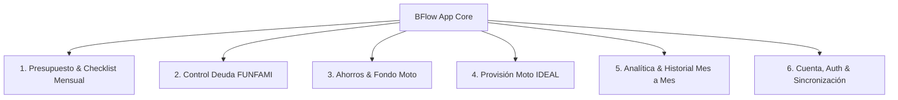

# BFlow — Gestión de Flujo de Caja Personal & Provisiones Inteligentes

[](https://expo.dev/)
[](https://reactnative.dev/)
[](https://react.dev/)
[](https://www.typescriptlang.org/)
[](https://firebase.google.com/)
[](https://developer.apple.com/ios/)
[](https://jestjs.io/)
[](https://jestjs.io/)
[](#)

> **BFlow** es una aplicación financiera móvil y web de alto rendimiento diseñada con estética **Apple iOS 26 Liquid Glass**, optimizada para iPhone 16 Pro Max y pensada para resolver el control de presupuesto personal mes a mes, amortizaciones de deuda y provisiones vehiculares. Reemplaza hojas de cálculo manuales de Excel mediante cálculo matemático determinístico, sincronización en tiempo real con Cloud Firestore y widgets nativos para iOS.

---

## 📑 Tabla de Contenidos

1. [Visión y Problema que Resuelve](#-visión-y-problema-que-resuelve)
2. [Módulos Funcionales Core](#-módulos-funcionales-core)
3. [Fuente de Verdad & Invariantes Matemáticas (Excel vs BFlow)](#-fuente-de-verdad--invariantes-matemáticas-excel-vs-bflow)
4. [Arquitectura de Doble Modo (Modo A vs Modo B)](#-arquitectura-de-doble-modo-modo-a-vs-modo-b)
5. [Sistema de Diseño Visual: Liquid Glass & SF Pro](#-sistema-de-diseño-visual-liquid-glass--sf-pro)
6. [Modelo de Datos & Reglas de Seguridad en Cloud Firestore](#-modelo-de-datos--reglas-de-seguridad-en-cloud-firestore)
7. [Widgets Nativos de iOS 26 (WidgetKit)](#-widgets-nativos-de-ios-26-widgetkit)
8. [Estructura del Proyecto y Capas](#-estructura-del-proyecto-y-capas)
9. [Instalación y Desarrollo Local](#-instalación-y-desarrollo-local)
10. [Tubería de CI/CD, Compilación y Firma (.ipa)](#-tubería-de-cicd-compilación-y-firma-ipa)
11. [Auditoría Integral de Calidad para Producción](#-auditoría-integral-de-calidad-para-producción)
12. [Variables de Entorno](#-variables-de-entorno)
13. [Reglas para Futuros Cambios y Documentación](#-reglas-para-futuros-cambios-y-documentación)

---

## 🎯 Visión y Problema que Resuelve

Las hojas de cálculo personales tradicionales son herramientas potentes pero presentan fricciones críticas para el día a día móvil:
- **Cero ergonomía táctil:** Marcar un pago en el momento de realizarlo en la calle es incómodo en una cuadrícula de celdas.
- **Fórmulas inconsistentes y errores silenciosos:** En el Excel original, rangos de suma tomaban filas fijas, las sumas de ingresos mezclaban previsiones con cobros reales y las deudas no reflejaban abonos individuales.
- **Falta de sincronización nativa en el dispositivo:** Sin widgets en la pantalla de inicio, consultar el flujo neto o el checklist exige abrir archivos pesados.

**BFlow traslada esta lógica a una experiencia moderna:**
- **Monto de dinero exacto:** Regla matemática inflexible de números enteros en pesos colombianos (COP), erradicando errores de redondeo de punto flotante.
- **Checklist de un toque con micro-haptics:** Marcar un ingreso o gasto completado actualiza al instante la caja, el widget y las metas.
- **Visualización a 120 Hz ProMotion:** Interfaces fluidas, soporte de Dynamic Type, modo oscuro y claro con contraste WCAG 2.2 AAA.
- **Cero costo de infraestructura:** Funciona 100% dentro de las capas gratuitas de Google Firebase (Spark Tier), GitHub Actions y cuenta gratuita de Apple Developer.

---

## 📦 Módulos Funcionales Core



### 1. Presupuesto Mensual & Checklist de Movimientos
- **Métricas Clave:**
  - `Ingresos Recibidos` vs `Ingresos Previstos`.
  - `Gastos Pagados` vs `Gastos Pendientes` (desglosados por Fijos y Variables).
  - `Flujo Neto en Vivo` ($\text{Recibido} - \text{Pagado}$) vs `Flujo Proyectado` ($\text{Previsto} - \text{Previsto}$).
- **Regla del Checklist Inteligente:**
  - Al abrir un mes (`ensureMonthPlan(monthKey)`), se generan de forma idempotente las entradas pendientes para conceptos recurrentes.
  - Al marcar un concepto no recurrente múltiple como completado, este desaparece del selector de "Agregar Movimiento" del mes en curso y reaparece automáticamente en el mes siguiente.
  - Al desmarcar o borrar un movimiento, el concepto se vuelve a habilitar de inmediato.

### 2. Control de Deuda FUNFAMI
- **Derivación Pura del Saldo:** El saldo restante nunca se almacena de forma mutable para prevenir desfases; se deriva estrictamente como:
  $$\text{SaldoActual}(d) = \text{SaldoApertura}(d) - \sum \text{AbonosActivosAprobados}(d)$$
- **Abonos a Capital:** La cuota mensual de `$ 1.800.000` abona 100% a capital cuando se marca pagada en el presupuesto, descontándose prioritariamente de la deuda `CB300F - MOTO` (`$ 4.400.000` $\to$ `$ 2.600.000`), manteniendo `ESP. IA` en `$ 3.600.000` y el total del grupo en `$ 6.200.000`.

### 3. Ahorros y Fondo Moto
- **Posición de Caja Doble:**
  - **Saldo en Vivo:** Apertura mes pasado + Flujo Neto del mes (`$ 2.080.000` en octubre 2026).
  - **Saldo Proyectado tras Pendientes:** Saldo en vivo menos los gastos pendientes restantes (`$ 2.080.000 - $ 450.000 = $ 1.630.000`), protegiendo al usuario de asumir liquidez que ya está comprometida.
- **Fondo Moto:** Acumula automáticamente los aportes vinculados que ya están pagados (`CB300F` + `Gasolina Moto/Carro` = `$ 2.300.000` en octubre 2026).

### 4. Provisión "Moto IDEAL"
- **Costos Recurrentes de Operación:** SOAT, Impuestos, Casco, Llantas, Mantenimiento, Parqueadero, Cambio de Aceite y Gasolina, calculados con redondeo hacia arriba en enteros COP (`Math.ceil(anual / 12)` = `$ 872.667`/mes).
- **Metas Puntuales (`TargetGoal`):** Como el `Kit de arrastre Honda original ($ 500.000)` con fecha objetivo `Agosto 2027`, permitiendo comparar la provisión ideal frente al aporte real al fondo de la moto.

### 5. Analítica & Historial Mes a Mes
- Cierres mensuales inmutables mediante `MonthSnapshot`.
- Gráficos interactivos de distribución de gastos, comparativas mes a mes y evolución de la deuda con proyección de fecha de liquidación final.

---

## 📐 Fuente de Verdad & Invariantes Matemáticas (Excel vs BFlow)

El archivo [`fixtures/october-2026.json`](file:///c:/Users/ALEJO%20BERNAL/Documents/PROYECTOS/BFlow/fixtures/october-2026.json), extraído mediante `scripts/extract-excel-fixture.mjs` del libro Excel original, constituye la **Fuente de Verdad Dorada**. 

### Resolución Confirmada de las 9 Inconsistencias del Excel
En la Fase 0 del proyecto se auditaron y resolvieron formalmente las 9 inconsistencias detectadas en la hoja `Octubre 2026`:

| # | Problema Detectado en Excel | Solución Aprobada e Implementada en BFlow | Valor Dorado Verificado (Oct 2026) |
| :-: | :--- | :--- | :--- |
| **1** | `B2` (`=B17`) solo sumaba ingresos recibidos pese a llamarse *"Previstos"*. | Separa explícitamente `receivedIncome` de `plannedIncome`, y calcula tanto `netCashFlow` como `projectedNetFlow`. | `received = $ 4.000.000`<br>`planned = $ 6.000.000`<br>`net = $ 1.080.000`<br>`projected = $ 2.630.000` |
| **2** | `H18/H24` solo sumaban gastos pagados. | Expone la terna completa (Previsto / Pagado / Pendiente) para Fijos y Variables. | **Fijos:** `2.970.000 / 2.620.000 / 350.000`<br>**Variables:** `400.000 / 300.000 / 100.000` |
| **3** | Deuda restaba la cuota sin verificar si estaba pagada ni a cuál crédito pertenecía. | La cuota solo amortiza si `status === 'completed'`. Abona 100% a capital de `CB300F - MOTO`. | `cb300f = $ 2.600.000`<br>`espIa = $ 3.600.000`<br>`totalDebt = $ 6.200.000` |
| **4** | `Moto - Ahora` sumaba celdas fijas (`H10+H16`) sin validar pago. | Aportes configurables por concepto con validación estricta de pago (`onlyWhenCompleted: true`). | `motoCurrentBalance = $ 2.300.000` |
| **5** | `Ahorros - Ahora` no alertaba sobre gastos pendientes por pagar. | Muestra `Ahorros en Vivo` y `Ahorros Proyectado tras Pendientes`. | `current = $ 2.080.000`<br>`projected = $ 1.630.000` |
| **6** | Saldos *"Mes Pasado"* se copiaban a mano cada mes. | Flujo automatizado de `closeMonthAndRollover` que congela snapshot y arrastra aperturas. | Apertura Nov 2026 generada con 1 toque. |
| **7** | En el cuadro IDEAL los montos eran texto y excluían el kit de arrastre ($500.000). | Tipado numérico exacto en enteros y kit tratado como meta puntual para `2027-08`. | `operativo = $ 872.667`<br>`conMeta = $ 1.372.667` |
| **8** | `Prima` figuraba como fija mensual pese a ser estacional. | Modelado con `recurrence: { kind: 'specific_months', months: [6, 12] }`. | Entrada conservada en Oct 2026 para paridad del fixture (6/12 listos). |
| **9** | Solapamiento entre conceptos del presupuesto y renglones de la moto. | Enlace bidireccional (`linkedConceptId: 'exp_gasolina_moto_carro'`). Gasolina sí es el mismo gasto; Parqueadero CEM es independiente. | Fixture verificado con 0 discrepancias. |

### Regla de Hierro del Dinero (Integer Math)
- En BFlow está **estrictamente prohibido el uso de flotantes o decimales** para almacenar, transportar o sumar dinero.
- Todo monto es un entero seguro en COP validado con `Number.isSafeInteger(amount) && amount >= 0`.
- El formateador monetario en [`src/domain/money/money.ts`](file:///c:/Users/ALEJO%20BERNAL/Documents/PROYECTOS/BFlow/src/domain/money/money.ts) garantiza renderizado idéntico al Excel (`"$ 1.080.000"`).

### Regla de Zona Horaria
- Toda clave de mes (`monthKey`) y fecha de completado se procesa de forma inmutable en **`America/Bogota` (`UTC-05:00`)**, garantizando consistencia en cambios de año o de mes sin importar el huso del cliente.

---

## 🔄 Arquitectura de Doble Modo (Modo A vs Modo B)

Para permitir el desarrollo diario sin fricción en **Windows 11 sin Mac local**, BFlow implementa una separación estricta mediante adaptadores en `src/platform/`:

```
┌────────────────────────────────────────────────────────────────────────┐
│                        BFlow Application Code                          │
│     (src/domain, src/features, src/design-system, src/app)             │
└───────────────────────────────────┬────────────────────────────────────┘
                                    │
                       runtimeMode.ts interface
                                    │
           ┌────────────────────────┴────────────────────────┐
           ▼                                                 ▼
┌──────────────────────────────────────┐  ┌──────────────────────────────────────┐
│      MODO A (Expo Go / Web)          │  │       MODO B (.ipa Nativo iOS 26)    │
│  - Desarrollo en Windows 11          │  │  - Compilado en GitHub Actions macOS │
│  - Expo Go en iPhone 16 Pro Max      │  │  - Instalado vía iloader (Sideload)  │
│  - Fallback <GlassSurface /> (Blur)  │  │  - expo-glass-effect (UIVisualEffect)│
│  - Firebase JS SDK + Auth            │  │  - Widgets nativos (WidgetKit Swift) │
│  - Adaptador No-Op de Widgets        │  │  - ActivityKit Dynamic Island ready  │
└──────────────────────────────────────┘  └──────────────────────────────────────┘
```

### Mitigación de Restricciones en Cuenta Apple Gratuita (7 Días / 2 App IDs)
1. **Límite de 3 Apps Sideloaded:** No interfiere si se mantiene como máximo 2 apps adicionales instaladas.
2. **Límite de 10 App IDs por semana (Crítico):**
   - Para no agotar la cuota semanal, todos los 6 widgets y la Live Activity están unificados en **UN ÚNICO target de extensión (`targets/widgets`)**.
   - BFlow consume **exactamente 2 App IDs**: `com.bflow.app` (App) + `com.bflow.app.widgets` (Extensión).
3. **Resguardo de Datos ante Renovación de Firma:**
   - Como la firma gratuita caduca a los 7 días, todos los datos residen en **Cloud Firestore** con sincronización en tiempo real.
   - Reinstalar o firmar el `.ipa` encima con `iloader` **conserva la sesión y restaura el 100% de la información en segundos**.

---

## 🎨 Sistema de Diseño Visual: Liquid Glass & SF Pro

> **Multiplataforma con tres pieles (ADR 0010 y 0011).** Lo que sigue describe la piel **iOS**. **Android** usa Material 3 (superficies tonales opacas, barra de navegación anclada, ripple; sin Liquid Glass) y **Web** un sistema plano (paleta arena y negro con acento petróleo, tipografía Geist, cabecera fija, composición de escritorio a dos columnas y curva del mes vectorial animada, ADR 0012). La curva del mes es una escena three.js solo en iOS; Android usa la misma curva vectorial animada que Web, con gesto táctil (ADR 0014). Los tokens de cada piel y el contrato responsive están en `DESIGN.md` §10 y §11.

Documentado a profundidad en [`DESIGN.md`](file:///c:/Users/ALEJO%20BERNAL/Documents/PROYECTOS/BFlow/DESIGN.md) y centralizado en [`src/design-system/tokens.ts`](file:///c:/Users/ALEJO%20BERNAL/Documents/PROYECTOS/BFlow/src/design-system/tokens.ts):

- **Estética Sobria y Amigable:** Lenguaje financiero de alta gama (Apple Wallet, Linear, Stripe). Cero marcos de neón perimetrales o brillos estilo videojuego.
- **Paleta de Superficies:**
  - *Modo Oscuro:* Obsidiana Carbón Cálido (`#0D0F12`), Grafito Ahumado (`#14171C`), Titanio Pizarra (`#1B1F26`).
  - *Modo Claro:* Arena Piedra (`#E7E6E0`), Lino Tostado (`#DCDBD3`), Marfil Arena (`#EFECE3`).
- **Contraste WCAG 2.2 AAA:** Texto primario con ratio de contraste `> 15:1` frente a los fondos.
- **Tipografía SF Pro con Números Tabulares:** Toda cifra monetaria utiliza obligatoriamente `fontVariant: ['tabular-nums']` para erradicar el baile horizontal de dígitos en animaciones de conteo.
- **Soporte Dynamic Type:** Todos los componentes respetan `allowFontScaling={true}`.
- **Ergonomía Táctil:** Botones con área táctil mínima de `44pt` (`MIN_TOUCH_TARGET_PT`) y `hitSlop` perimetral.
- **Micro-interacciones y Háptica:** `TactilePressable` con amortiguación física de resorte y retroalimentación háptica calibrada mediante `hapticService`.

---

## 🔒 Modelo de Datos & Reglas de Seguridad en Cloud Firestore

### Esquema Aislado Multi-Inquilino
Toda la información del usuario vive de forma estrictamente privada bajo `users/{uid}/...`:

```text
users/{uid}
├── concepts/{conceptId}          # Catálogo personal de ingresos y gastos
├── entries/{entryId}             # Movimientos mensuales (${monthKey}_${conceptId})
├── debts/{debtId}                # Deudas registradas (FUNFAMI, etc.)
├── debtPayments/{paymentId}      # Abonos aplicados a cada crédito
├── savingsBuckets/{bucketId}     # Fondos de ahorro (Moto, General)
├── provisionPlans/{planId}       # Plan IDEAL de provisiones y metas
└── monthSnapshots/{monthKey}     # Cierres mensuales inmutables
```

### Optimización Extrema del Plan Spark (100% Gratuito)
- **Límites Spark:** 50.000 lecturas / 20.000 escrituras por día.
- **Consumo Real de BFlow:**
  - Apertura en frío con caché: **~43 lecturas**.
  - Operación diaria normal: **< 100 lecturas/día (< 0,2% del límite)** y **< 30 escrituras/día (< 0,15% del límite)**.
- **Margen de seguridad:** Superior al **99,8% dentro de la capa gratuita**.

### Reglas de Seguridad en [`firestore.rules`](file:///c:/Users/ALEJO%20BERNAL/Documents/PROYECTOS/BFlow/firestore.rules)
- **503 líneas de validación estricta:**
  - `isOwner(uid)` obligatorio en cada nodo.
  - Comprobación de campos obligatorios (`hasRequiredFields`) y bloqueo de campos extraños (`hasOnlyAllowedFields`).
  - Validación de enteros positivos (`isNonNegativeInt`), expresiones regulares para `monthKey` (`^\d{4}-(0[1-9]|1[0-2])$`), enumeraciones cerradas de estados (`pending`, `completed`) y cadenas con límite de longitud.
  - Inmutabilidad de claves críticas en operaciones de actualización (`update`).
  - Denegación total por defecto (`match /{document=**} { allow read, write: if false; }`).

---

## 📱 Widgets Nativos de iOS 26 (WidgetKit)

Widgets de iOS en [`targets/widgets/`](targets/widgets/) (SwiftUI, compilados con `@bacons/apple-targets`) y de Android en [`modules/bflow-widgets/`](modules/bflow-widgets/) (módulo Expo local con RemoteViews y WorkManager). Decisión completa en el [ADR 0021](docs/decisions/0021-home-screen-widgets-ios-android.md).

| Widget | iOS | Android | Contenido |
| :--- | :--- | :--- | :--- |
| Flujo neto | small + pantalla de bloqueo | 2×2 | Flujo neto del mes con signo, checklist x de y |
| Resumen | medium | 4×2 | Recibido, pagado, por pagar y mini gráfico de 6 meses |
| Pendientes | large | 4×4 | Checklist de pendientes con montos |
| Deudas | small, medium, circular | 3×2 | Restante, % pagado y cierre estimado |
| Ahorros | small, medium | 2×2 / 3×2 | Total y bolsillos |

- **Contrato tipado `WidgetSnapshotV2`** (`src/platform/widgets/widgetSnapshot.ts`), calculado solo en TypeScript.
- **Sincronización:** al instante con los cambios del mismo teléfono; los cambios de otro dispositivo llegan desde `users/{uid}/widgetSnapshots/current` cada ~15 min o con el botón «Actualizar» (sin push: requeriría cuentas de pago).

---

## 📂 Estructura del Proyecto y Capas

```text
BFlow/
├── .agents/                      # Configuración de agentes, roles y skills (Antigravity)
├── .github/
│   └── workflows/                # CI/CD (ci.yml, build-ios.yml, build-android.yml, e2e.yml)
├── assets/                       # Iconos y splash screens de la aplicación
├── docs/
│   ├── decisions/                # Architecture Decision Records (ADR 0001 a 0016)
│   ├── guides/                   # Guías operativas (firma con iloader, validación multiplataforma)
│   └── Improvements/             # Guías de auditoría de rendimiento
├── fixtures/                     # Datos dorados de prueba (october-2026.json)
├── scripts/                      # Scripts de utilidad (linting, guardias CI, start-demo.mjs del modo vitrina)
├── src/
│   ├── app/                      # Expo Router (punto de entrada _layout.tsx, index.tsx)
│   ├── data/                     # Repositorios Firestore, esquemas Zod, seeds
│   │   ├── firebase/             # Configuración Firebase SDK, persistencia Auth por plataforma y emulador
│   │   ├── mappers/              # Esquemas de validación Zod
│   │   ├── repositories/         # budgetRepository.ts (acceso a datos)
│   │   └── seed/                 # Carga de datos iniciales de octubre 2026
│   ├── design-system/            # Tokens por piel (iOS / Android / Web), tema y componentes base
│   │   ├── components/           # AppPressable, AppText, CurrencyText, ResponsiveColumns…
│   │   │   ├── charts/           # Gráficos animados SVG: barras, línea y dona (ADR 0020)
│   │   │   └── navigation/       # Dock iOS, barra Material (Android), cabecera y barra Web
│   │   ├── layout/               # Contrato responsive (useResponsiveLayout) y ancho de cifras
│   │   ├── platform/             # Resolución de la piel y preferencia de Reducir Movimiento
│   │   └── theme/                # BFlowThemeProvider / useBFlowTheme
│   ├── domain/                   # 100% PURO: Fórmulas matemáticas, checklist, deudas, ahorros
│   │   ├── analytics/            # Series de los gráficos: historial de 6 meses, distribución, comparativa
│   │   ├── budget/               # Cálculos de ingresos, gastos y flujos netos
│   │   ├── checklist/            # Reglas de disponibilidad, progreso y autogeneración
│   │   ├── date/                 # Manejo inmutable de monthKey y zona horaria Bogotá
│   │   ├── debts/                # Derivación de saldos y abonos de deuda
│   │   ├── money/                # Operaciones enteras en COP y formateo
│   │   ├── month-close/          # Lógica de cierre de mes y arrastre a apertura siguiente
│   │   ├── moto-ideal/           # Provisiones y metas del cuadro IDEAL
│   │   ├── overview/             # Reconstrucción diaria de la curva del mes
│   │   └── savings/              # Fondos de ahorro y proyecciones
│   ├── features/                 # Pantallas y componentes por dominio funcional
│   │   ├── analytics/            # Cierre de mes, historial y sección «Gráficos»
│   │   ├── auth/                 # Login, registro, perfil y recuperación
│   │   ├── budget/               # Resumen mensual y modal de agregar movimiento
│   │   ├── checklist/            # Lista de movimientos y filtros
│   │   ├── debts/                # Amortización de deudas, abonos y gráfico de evolución
│   │   ├── onboarding/           # Configuración inicial de usuario nuevo
│   │   ├── savings/              # Tarjetas de fondos, provisión moto y gráfico de evolución
│   │   ├── shell/                # WorkspaceShell: cabecera, columna y navegación de cada piel
│   │   └── summary/              # Resumen y curva del mes: three.js (iOS), SVG animado (Android, Web y respaldo de iOS)
│   └── platform/                 # Adaptadores Modo A vs Modo B
│       ├── auth/                 # Adaptador de autenticación y códigos de 6 dígitos
│       ├── glass/                # GlassSurface: vidrio (iOS), tonal (Android), plano (Web)
│       ├── haptics/              # Servicio unificado de vibración háptica
│       ├── insets/               # Áreas seguras (borde a borde en Android)
│       ├── mail/                 # Integración de correos transaccionales vía Resend API
│       ├── mode/                 # Detección de entorno (runtimeMode.ts) y modo vitrina (demoMode.ts)
│       ├── storage/              # Persistencia KV síncrona cifrada (AES-256 + HMAC-SHA256, expo-secure-store + expo-sqlite/kv-store en iOS/Android, localStorage cifrado en Web) y caché v2
│       ├── system/               # Fondo de la ventana nativa / documento HTML según el tema
│       └── widgets/              # Serialización y puente de sincronización con WidgetKit
├── plugins/                      # Config plugins locales del prebuild (reglas keep de R8 para Android, ADR 0013)
├── targets/
│   └── widgets/                  # Target nativo SwiftUI para Widgets de iOS 26
├── AGENTS.md                     # Reglas de ingeniería, roles y Definición de Terminado
├── app.json                      # Configuración de Expo y plugins nativos
├── DESIGN.md                     # Manual y fuente de verdad del Sistema de Diseño
├── firestore.rules               # Reglas declarativas de seguridad de Cloud Firestore
├── package.json                  # Dependencias y scripts de ejecución
└── PERF_BASELINE.md              # Línea base de rendimiento y registro de optimizaciones
```

---

## 🚀 Instalación y Desarrollo Local

### Prerrequisitos
- **Sistema Operativo:** Windows 11, macOS o Linux.
- **Node.js:** Versión `22.x` o superior (se recomienda Node 22 LTS).
- **Gestor de paquetes:** `npm` versión `10.x` o `11.x`.
- **Dispositivo móvil (Opcional):** iPhone físico con la aplicación **Expo Go** instalada desde el App Store.

### Pasos de Instalación

1. **Clonar el repositorio:**
   ```bash
   git clone https://github.com/AleBer2303/BFlow.git
   cd BFlow
   ```

2. **Instalar dependencias:**
   ```bash
   npm ci --legacy-peer-deps
   ```
   *(El script postinstall aplicará automáticamente el parche de almacenamiento para extensiones nativas. Este paso también instala `three`, `expo-gl`, `expo-sqlite` y `expo-secure-store`, usados por la escena 3D de Resumen y la persistencia local nativa cifrada con Keychain/Keystore + `expo-sqlite/kv-store`; todos vienen incluidos en Expo Go y no requieren configuración adicional).*

3. **Configurar variables de entorno:**
   ```bash
   cp .env.example .env
   ```
   *(Los valores predeterminados de Firebase ya apuntan al proyecto configurado `bflow-deaeb`).*

4. **Ejecutar verificaciones de calidad:**
   ```bash
   npm run typecheck       # Verificación estricta de TypeScript (0 errores)
   npm run lint            # Linting y chequeo de arquitectura
   npm test                # Suite de tests unitarios, de integración y funcionales por plataforma
   ```

5. **Iniciar el servidor de desarrollo:**
   - **En el navegador Web:**
     ```bash
     npm run web
     ```
   - **En Expo Go (iPhone):**
     ```bash
     npm start
     ```
     Escanea el código QR que aparece en la terminal con la cámara de tu iPhone para abrir BFlow en Expo Go.
   - **En Android (emulador o dispositivo con Expo Go):**
     ```bash
     npm run android
     ```
   - **Modo vitrina, para revisar las tres pieles sin credenciales:**
     ```bash
     npm run web:demo
     ```
     Abre `http://localhost:8081/?skin=android`, `?skin=ios` o `?theme=light`. Pasos completos en [`docs/guides/multiplatform-validation-guide.md`](docs/guides/multiplatform-validation-guide.md).

---

## 🛠 Tubería de CI/CD, Compilación y Firma (.ipa)

Toda la automatización de BFlow se ejecuta en **GitHub Actions**:

### 1. `ci.yml` (Puerta de Enlace de Calidad en Linux)
Se ejecuta en cada `push` a las ramas `main` o `develop`, y en cada Pull Request:
- Comprueba paridad con el fixture de Excel (`scripts/extract-excel-fixture.mjs`).
- Evalúa la guardia heurística: cualquier cambio en `src/` debe incluir tests nuevos o actualizados (`scripts/check-src-tests-guard.mjs`).
- Ejecuta `npm run typecheck`, `npm run lint` y `npm test -- --coverage`.

### 2. `build-ios.yml` (Compilación Nativa en macOS Gratuito)
Se ejecuta en cada `push` a `main` o al crear una etiqueta de versión `v*`:
- Utiliza un runner **`macos-26`** de GitHub Actions con Xcode 26+ (Swift 6.2+).
- Genera el proyecto nativo mediante `npx expo prebuild --platform ios --clean`.
- Compila con `xcodebuild` deshabilitando temporalmente la firma de código.
- Empaqueta el bundle en `BFlow-unsigned.ipa` y lo publica automáticamente en **GitHub Releases**.

### 3. Instalación en iPhone con `iloader` (Ciclo de 7 Días)
Sigue la guía detallada en [`docs/guides/iloader-signing-guide.md`](file:///c:/Users/ALEJO%20BERNAL/Documents/PROYECTOS/BFlow/docs/guides/iloader-signing-guide.md):
1. Descarga el último `BFlow-unsigned.ipa` desde [GitHub Releases](https://github.com/AleBer2303/BFlow/releases).
2. Conecta tu iPhone por cable a tu PC con Windows 11 y abre **iloader** (o Sideloadly).
3. Selecciona el archivo `.ipa`, ingresa tu Apple ID gratuito e inicia la instalación.
4. **Renovación a los 7 días:** No desinstales la app; simplemente vuelve a conectar el iPhone e instala el `.ipa` encima para conservar todos los datos locales.

---

## 📊 Auditoría Integral de Calidad para Producción

Como parte de la evaluación técnica exhaustiva requerida antes de un lanzamiento masivo en tiendas de aplicaciones (App Store / Google Play / Web PWA), se clasifican los aspectos del proyecto en tres niveles de madurez:

### ✅ Aspectos que Cumplen al 100% con Estándares de Producción
1. **Lógica de Dominio y Cobertura:** Cobertura de tests superior al **99%** en `src/domain/` (123 tests pasando), verificación con fixture de datos reales y tolerancia cero a flotantes financieros.
2. **Seguridad en Firestore:** Reglas declarativas completas (503 líneas) con validación granular de esquemas, tipos, longitudes y permisos de lectura/escritura cerrados por `request.auth.uid`.
3. **Resiliencia de Red y Optimistic Rollback:** Reversión automática de estado local en Zustand si falla la conexión con Firebase, acompañada de feedback al usuario.
4. **Eficiencia en Capa Gratuita:** Consumo menor a 100 lecturas diarias en Cloud Firestore Spark (< 0,2% del cupo diario).
5. **Doble Modo Estricto:** Capacidad comprobada de correr sin crasheos en Expo Go / Web (Modo A) y compilar binarios nativos con extensiones WidgetKit (Modo B).
6. **Diseño Visual e Inclusividad:** Cumplimiento riguroso de WCAG 2.2 AAA en contraste tipográfico, soporte Dynamic Type, modo oscuro/claro y áreas táctiles de 44pt.
7. **CI/CD Automatizado:** Pipeline en GitHub Actions con guardias heurísticas y publicación automatizada de binarios.

### ✅ Aspectos Existentes Mejorados y Optimizados (Implementado - ADR 0006, ADR 0015 y ADR 0016)
1. **Persistencia Local Cifrada y Caché de Cuenta Offline (2.2.1):**
   - *Solución:* Implementación de `persistentStorageAdapter` con cifrado simétrico autenticado **AES-256-CTR + HMAC-SHA256 (`storageCipher.ts`, ADR 0016)** cuya llave se deriva de una palabra secreta de aplicación (`EXPO_PUBLIC_LOCAL_CIPHER_PEPPER`) más un token aleatorio de 256 bits generado y custodiado en **`expo-secure-store` (iOS Keychain / Android Keystore)**; custodia directa del token de sesión activa en `expo-secure-store` en nativo (`storageBackend.native.ts` y `authPersistence.native.ts`); almacenamiento del presupuesto cifrado en `expo-sqlite/kv-store` (iOS/Android) y `localStorage` (Web); sobre versionado `v2` en `accountCache` (`{ schemaVersion, uid, savedAt, data }`) con borrado y rotación de llave al cerrar sesión o reiniciar cuenta.
   - *Impacto:* La sesión y la caché de cuenta sobreviven al cierre de la app en iOS, Android y Web hidratando desde el frame 0 sin plantillas ni valores en `$ 0`, y manteniendo el 100% de los datos y tokens locales cifrados e ilegibles fuera de la sesión autenticada.
2. **Modularización del Store Global en Slices (2.2.2):**
   - *Solución:* Descomposición de `useBudgetStore.ts` (originalmente de 1.984 líneas) en 6 slices en `src/features/budget/store/slices/`: `createAuthSlice`, `createSyncSlice`, `createBudgetSlice`, `createDebtsSlice`, `createSavingsSlice` y `createProvisionsSlice`.
   - *Impacto:* `useBudgetStore.ts` reducido a menos de 45 líneas conservando 100% la compatibilidad retroactiva.
3. **Optimización de Renderizado y Componentes Memoizados (2.2.3):**
   - *Solución:* Extracción de `SummaryMovementRow`, `ChecklistRowItem` y `HistoryMonthRowItem` envueltos en `React.memo` para aislar eventos táctiles, animaciones y micro-haptics.
   - *Impacto:* Evita re-renderizados masivos en listas de movimientos al marcar o editar ítems, asegurando 60/120 fps constantes.
4. **Optimización y Compresión de Assets Gráficos (2.2.4):**
   - *Solución:* Creación del script `scripts/optimize-assets.mjs` con filtrado adaptativo PNG (Paeth, Sub, Up, Average) y compresión Deflate nivel 9.
   - *Impacto:* Reducción de más de **1.8 MB** (ahorro del **51%** en `icon.png` y `adaptive-icon.png`, 27% en `favicon.png`) manteniendo 100% la paridad de píxeles.

### 🚀 Aspectos Faltantes para Publicación en Tiendas (App Store / Google Play)
1. ✅ **Configuración de Android en `app.json`** (ADR 0009): bloque `android` con `package`, `versionCode` y `adaptiveIcon`.
2. ✅ **Workflow de Build Android en CI (`build-android.yml`)** (ADR 0009): genera `.apk` de prueba y `.aab` en `ubuntu-latest`. El release se compila con R8; las reglas keep del proyecto las añade `plugins/withAndroidKeepRules.js` en cada prebuild (ADR 0013).
3. **Splash Screen Oficial (`expo-splash-screen`):**
   - *Falta:* Declarar la configuración de pantalla de carga nativa en `app.json` para evitar transiciones en blanco en arranques en frío.
4. **Flujos de Pruebas E2E en Maestro:**
   - *Falta:* Completar los archivos de flujo `.yaml` en `e2e/` para validar el recorrido completo de usuario (registro $\to$ pago $\to$ cierre) de forma desatendida.
5. **Monitoreo de Errores y Telemetría en Producción:**
   - *Falta:* Integración de Sentry Expo o Firebase Crashlytics para capturar excepciones no controladas en dispositivos de usuarios finales.
6. **Cumplimiento Legal de Tiendas (Política de Privacidad y Borrado de Cuenta):**
   - *Falta:* Publicar `PRIVACY_POLICY.md` en web pública y habilitar la eliminación completa del usuario en Firebase Auth conforme a la directriz 5.1.1(v) de Apple.

---

## 🔑 Variables de Entorno

Configurables en el archivo `.env` local (basado en `.env.example`):

| Variable | Descripción | Valor Predeterminado / Ejemplo |
| :--- | :--- | :--- |
| `EXPO_PUBLIC_FIREBASE_API_KEY` | Llave pública de Firebase Web Client | `AIzaSy...` (Proyecto `bflow-deaeb`) |
| `EXPO_PUBLIC_FIREBASE_AUTH_DOMAIN` | Dominio de autenticación de Firebase | `bflow-deaeb.firebaseapp.com` |
| `EXPO_PUBLIC_FIREBASE_PROJECT_ID` | Identificador de proyecto Firebase | `bflow-deaeb` |
| `EXPO_PUBLIC_FIREBASE_STORAGE_BUCKET` | Bucket de almacenamiento | `bflow-deaeb.firebasestorage.app` |
| `EXPO_PUBLIC_FIREBASE_MESSAGING_SENDER_ID`| Sender ID para mensajería | `1021469032737` |
| `EXPO_PUBLIC_FIREBASE_APP_ID` | App ID asignado en Firebase Console | `1:1021469032737:web:8656ad9e4871ddb6ffce73` |
| `EXPO_PUBLIC_RESEND_API_KEY` | API Key de Resend para correos reales | Opcional (si falta, simula en consola en desarrollo) |
| `EXPO_PUBLIC_RESEND_FROM_EMAIL` | Dirección remitente autorizada en Resend| `BFlow <onboarding@resend.dev>` |
| `EXPO_PUBLIC_LOCAL_CIPHER_PEPPER` | Semilla/palabra secreta de aplicación combinada con el token de 256 bits de `expo-secure-store` para derivar la llave AES-256 local (ADR 0016) | Opcional (incluye semilla criptográfica integrada por defecto) |
| `EXPO_PUBLIC_BFLOW_DEMO` | Modo vitrina local: sesión demo con el seed, sin Firebase, y `?skin=` / `?theme=` en la URL | Vacío (lo activa `npm run web:demo`). **Nunca** definirlo en builds reales |

---

## 📜 Reglas para Futuros Cambios y Documentación

Todas las contribuciones y cambios en el código deben regirse estrictamente por [`AGENTS.md`](file:///c:/Users/ALEJO%20BERNAL/Documents/PROYECTOS/BFlow/AGENTS.md):
- **Docs-as-Code:** Toda alteración en contratos, modelos o interfaces debe acompañarse de su correspondiente actualización documental en el mismo commit.
- **Criterios de ADR:** Cambios arquitectónicos o de dependencias exigen un nuevo documento en `docs/decisions/`.
- **Definition of Done:** `npm run typecheck` (0 errores), `npm run lint` (0 errores) y `npm test` (100% tests pasando y cobertura de dominio $\ge 90\%$).

---

*Desarrollado con ingeniería rigurosa y pasión por el diseño de interfaces fluidas.*  
*BFlow © 2026.*
