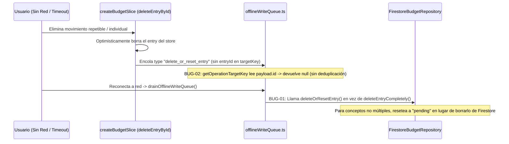

# Auditoría Integral de Documentación, Clean Code, Refactorización y Optimización — BFlow

> **Tipo Diátaxis:** *Reference & Explanation* (Auditoría Técnica Basada en Evidencia Real).
> **Rol Rector:** `documentation-expert` ([`.agents/agents/documentation-expert.md`](file:///c:/Users/D0604763/Documents/BFlow/BFlow/.agents/agents/documentation-expert.md)) con estándares `/clean-code`, `/refactor-code` y [`AGENTS.md`](file:///c:/Users/D0604763/Documents/BFlow/BFlow/AGENTS.md).
> **Fecha de Auditoría:** `2026-11-18`

> [!IMPORTANT]
> **Auditoría 100% Basada en Evidencia Real (Cero Suposiciones):** Todos los hallazgos, conteos y líneas citadas en este informe fueron verificados directamente sobre el código fuente actual, las reglas de Firestore, los 29 ADRs, las guías operativas y la ejecución real de `npm run typecheck` (`0 errores`), `npm run lint` (`0 errores`, 237 archivos fuente verificados), `npx jest --listTests` (`83 suites`) y `firestore.rules` (`490 líneas`). **No se modificó ningún archivo de `src/` ni de configuración durante esta auditoría.**

---

## Tabla de Contenidos

1. [Resumen Ejecutivo y Matriz Consolidada de Hallazgos](#1-resumen-ejecutivo-y-matriz-consolidada-de-hallazgos)
2. [Validación de Documentación (`documentation-expert` + Diátaxis & Docs-as-Code)](#2-validación-de-documentación-documentation-expert--diátaxis--docs-as-code)
   - [2.1. Evaluación frente al Checklist de `documentation-expert.md`](#21-evaluación-frente-al-checklist-de-documentation-expertmd)
   - [2.2. Hallazgos Documentales Detallados (`DOC-01` a `DOC-07`)](#22-hallazgos-documentales-detallados-doc-01-a-doc-07)
3. [Auditoría de Clean Code y Buenas Prácticas (`/clean-code` + `AGENTS.md`)](#3-auditoría-de-clean-code-y-buenas-prácticas-clean-code--agentsmd)
   - [3.1. Evaluación frente a los Principios de `/clean-code`](#31-evaluación-frente-a-los-principios-de-clean-code)
   - [3.2. Hallazgos de Clean Code y Arquitectura (`CC-01` a `CC-06`)](#32-hallazgos-de-clean-code-y-arquitectura-cc-01-a-cc-06)
4. [Defectos Funcionales y de Consistencia en Cola Offline y Repositorio (`BUG-01` a `BUG-04`)](#4-defectos-funcionales-y-de-consistencia-en-cola-offline-y-repositorio-bug-01-a-bug-04)
5. [Auditoría de Optimización y Rendimiento del Código (`OPT-01` a `OPT-06`)](#5-auditoría-de-optimización-y-rendimiento-del-código-opt-01-a-opt-06)
6. [Plan Sistemático de Refactorización por Fases (`/refactor-code` + Prompts)](#6-plan-sistemático-de-refactorización-por-fases-refactor-code--prompts)
7. [Verificación de Línea Base](#7-verificación-de-línea-base)

---

## 1. Resumen Ejecutivo y Matriz Consolidada de Hallazgos

La base de código de BFlow presenta un nivel de ingeniería sólido en su dominio contable puro (`src/domain/`, con enteros seguros en COP, zona horaria fija `America/Bogota` y pruebas doradas contra Excel), su arquitectura modular de almacenamiento cifrado (`src/platform/storage/`) y su documentación de decisiones (`docs/decisions/0001` a `0029`).

Sin embargo, el crecimiento rápido tras 6 fases de endurecimiento y optimización dejó **23 hallazgos concretos** agrupados en 4 ejes: **desfase documental** (`DOC-01` a `DOC-07`), **deuda de Clean Code y DRY** (`CC-01` a `CC-06`), **bugs silenciosos en la cola offline** (`BUG-01` a `BUG-04`) y **cuellos de botella de renderizado y caché** (`OPT-01` a `OPT-06`).

| ID | Categoría | Severidad | Hallazgo Principal Confirmado (Evidencia) | Fase |
| :--- | :--- | :---: | :--- | :---: |
| **DOC-01** | Documentación | `[HIGH]` | Desfase de conteos y versiones en `README.md` (`123` tests vs `83` suites; `503` vs `490` líneas en `firestore.rules`) y `PERF_BASELINE.md` §2/§4 (`Expo ~58.0.21` vs `~58.0.23`, `Zod ^3.24.2` vs `^4.6.7`, `1.774 KB` vs `890.512 bytes`). | **Fase 1** |
| **DOC-02** | Documentación | `[HIGH]` | 12 enlaces rotos con rutas locales absolutas de otro equipo (`ALEJO BERNAL`) en `README.md` y `ADR 0006`, más ancla inexistente `#-variables-de-entorno` en [README.md](file:///c:/Users/D0604763/Documents/BFlow/BFlow/README.md#L30). | **Fase 1** |
| **DOC-03** | Documentación | `[MEDIUM]` | El árbol arquitectónico de [README.md](file:///c:/Users/D0604763/Documents/BFlow/BFlow/README.md#L227-L292) omite `modules/bflow-widgets/`, `e2e/`, `src/domain/auth/`, `src/domain/provisions/`, `src/domain/models/`, `src/platform/dialogs/` y `src/platform/perf/`. | **Fase 1** |
| **DOC-04** | Documentación | `[MEDIUM]` | ADRs fundacionales (`0001`, `0002`, `0003`) siguen en estado `Propuesto (Fase 0)` y [ADR 0002](file:///c:/Users/D0604763/Documents/BFlow/BFlow/docs/decisions/0002-tech-stack-and-native-libraries.md) cita librerías/flags sustituidos (`react-native-gifted-charts`, `onSnapshot`, `exactOptionalPropertyTypes`) sin nota de reemplazo. | **Fase 1** |
| **DOC-05** | Documentación | `[LOW]` | [iloader-signing-guide.md](file:///c:/Users/D0604763/Documents/BFlow/BFlow/docs/guides/iloader-signing-guide.md) carece de cabecera Diátaxis explícita (`How-To Guide`), a diferencia de las demás guías en `docs/guides/`. | **Fase 1** |
| **DOC-06** | Documentación | `[LOW]` | Contradicción entre [DESIGN.md](file:///c:/Users/D0604763/Documents/BFlow/BFlow/DESIGN.md#L195) (háptica solo en `onPress`) y el JSDoc de [hapticService.ts](file:///c:/Users/D0604763/Documents/BFlow/BFlow/src/platform/haptics/hapticService.ts#L6) y [TactilePressable.tsx](file:///c:/Users/D0604763/Documents/BFlow/BFlow/src/design-system/components/TactilePressable.tsx#L4-L5) (prescriben `onPressIn`). | **Fase 1** |
| **DOC-07** | Docs-as-Code | `[LOW]` | [lint-check.mjs](file:///c:/Users/D0604763/Documents/BFlow/BFlow/scripts/lint-check.mjs) no valida enlaces Markdown rotos ni rutas absolutas `file:///c:/Users/...` en documentación. | **Fase 1** |
| **BUG-01** | Cola Offline | `[HIGH]` | `deleteEntryById` ([createBudgetSlice.ts](file:///c:/Users/D0604763/Documents/BFlow/BFlow/src/features/budget/store/slices/createBudgetSlice.ts#L616-L627)) encola `'delete_or_reset_entry'` en lugar de un tipo propio; al drenar ([offlineWriteQueue.ts](file:///c:/Users/D0604763/Documents/BFlow/BFlow/src/platform/storage/offlineWriteQueue.ts#L394-L399)) resetea a `pending` en vez de borrar. | **Fase 2** |
| **BUG-02** | Cola Offline | `[HIGH]` | `getOperationTargetKey` ([offlineWriteQueue.ts](file:///c:/Users/D0604763/Documents/BFlow/BFlow/src/platform/storage/offlineWriteQueue.ts#L130-L145)) busca `.id` en lugar de `entryId`/`conceptId`/`debtId`, devolviendo `null` en eliminaciones y rompiendo la deduplicación FIFO. | **Fase 2** |
| **BUG-03** | Cola Offline | `[MEDIUM]` | `completeInitialAccountSetup` ([createAuthSlice.ts](file:///c:/Users/D0604763/Documents/BFlow/BFlow/src/features/budget/store/slices/createAuthSlice.ts#L470-L487)) muestra *"Se sincronizará al conectar"* cuando falla la red, pero no encola la operación en `offlineWriteQueue`. | **Fase 2** |
| **BUG-04** | Integridad Datos | `[MEDIUM]` | `deleteSavingsBucket` ([createSavingsSlice.ts](file:///c:/Users/D0604763/Documents/BFlow/BFlow/src/features/budget/store/slices/createSavingsSlice.ts#L178-L202)) y `deleteDebt` ([createDebtsSlice.ts](file:///c:/Users/D0604763/Documents/BFlow/BFlow/src/features/budget/store/slices/createDebtsSlice.ts#L215-L252)) limpian solo en memoria o dejan huérfanos en Firestore (`concepts` y `debtPayments`). | **Fase 2** |
| **CC-01** | Clean Code (SRP) | `[HIGH]` | Archivos monolíticos "God Object": [budgetRepository.ts](file:///c:/Users/D0604763/Documents/BFlow/BFlow/src/data/repositories/budgetRepository.ts) (2.653 líneas; `loadFullCloudAccount` de 445 líneas) e [InitialAccountSetupView.tsx](file:///c:/Users/D0604763/Documents/BFlow/BFlow/src/features/onboarding/components/InitialAccountSetupView.tsx) (1.643 líneas, 26 `useState`, indentación corrida y typo `"ve al al final"`). | **Fase 4** |
| **CC-02** | Clean Code (DRY) | `[HIGH]` | Duplicación masiva: formularios de movimiento (~210 líneas duplicadas con háptica divergente), barras `Editar / Eliminar` (5 copias, ~350 líneas), slugs en 8 sitios (solo 1 normaliza tildes), conversión de tasas (3 sitios) y parseo numérico (12+ sitios). | **Fase 3** |
| **CC-03** | Clean Code (YAGNI) | `[MEDIUM]` | Código muerto: [zzSpikeGesture.test.tsx](file:///c:/Users/D0604763/Documents/BFlow/BFlow/src/design-system/__tests__/zzSpikeGesture.test.tsx) (`0` `expect`, `console.warn`), `applyCloudWorkspace` sin llamadores, parámetros muertos `_defaultMotoOpening`/`_defaultSavingsOpening`, props muertas en `AnalyticsAndHistoryView` y `DebtsFunfamiView`, e imports sin usar. | **Fase 3** |
| **CC-04** | Diseño & Reglas | `[MEDIUM]` | `testID` distintos por piel y `borderRadius` literal en [WorkspaceShell.tsx](file:///c:/Users/D0604763/Documents/BFlow/BFlow/src/features/shell/components/WorkspaceShell.tsx#L138-L231); `fontSize: 20` literal en forms de checklist; `Platform.OS` de layout en [AccountProfileWorkspaceView.tsx](file:///c:/Users/D0604763/Documents/BFlow/BFlow/src/features/auth/components/AccountProfileWorkspaceView.tsx#L406); emojis como iconos (`☁️`, `🎯`, `✨`); háptica en `onPressIn`; versión `v1.0.0` vs `0.1.0`. | **Fase 3** |
| **CC-05** | Clean Code (ADR 0005) | `[MEDIUM]` | Valores y nombres personales hardcodeados aún en código universal: healing `14_800_000`/`13_800_000`/`16_880_000` y `debt_cb300f_moto`/`debt_esp_ia` en [budgetRepository.ts](file:///c:/Users/D0604763/Documents/BFlow/BFlow/src/data/repositories/budgetRepository.ts#L1423-L1728) y [DebtsFunfamiView.tsx](file:///c:/Users/D0604763/Documents/BFlow/BFlow/src/features/debts/components/DebtsFunfamiView.tsx#L86). | **Fase 4** |
| **CC-06** | Tipado TS | `[LOW]` | Patrón `proxyBatch` con doble cast `as unknown as ReturnType<typeof writeBatch>` en `reopenMonthInCloud` y `deleteMonthInCloud` ([budgetRepository.ts](file:///c:/Users/D0604763/Documents/BFlow/BFlow/src/data/repositories/budgetRepository.ts#L2327-L2370)). | **Fase 4** |
| **OPT-01** | Rendimiento UI | `[HIGH]` | `WorkspaceTabKeepAlive` ([index.tsx](file:///c:/Users/D0604763/Documents/BFlow/BFlow/src/app/index.tsx#L137-L191)) mantiene suscritas al store a las pestañas ocultas: un cambio en `entries` dispara simultáneamente todos los calculadores y `buildMonthlyHistory` en hasta 5 pestañas montadas. | **Fase 5** |
| **OPT-02** | Persistencia / CPU | `[HIGH]` | Doble programación de `schedulePersistedAccountSave` ([index.tsx](file:///c:/Users/D0604763/Documents/BFlow/BFlow/src/app/index.tsx#L318-L332) y [sliceTypes.ts](file:///c:/Users/D0604763/Documents/BFlow/BFlow/src/features/budget/store/slices/sliceTypes.ts#L401)) más lectura y descifrado AES-256-CTR completo en `savePersistedAccount` y `updatePersistedAccountRevision` ([accountCache.ts](file:///c:/Users/D0604763/Documents/BFlow/BFlow/src/platform/storage/accountCache.ts#L158-L212)). | **Fase 5** |
| **OPT-03** | Rendimiento UI | `[MEDIUM]` | 26 `useState` en la raíz de [InitialAccountSetupView.tsx](file:///c:/Users/D0604763/Documents/BFlow/BFlow/src/features/onboarding/components/InitialAccountSetupView.tsx#L79-L136) re-renderizan los 6 pasos y listados del asistente completo en cada pulsación de teclado. | **Fase 4** |
| **OPT-04** | Complejidad / Red | `[MEDIUM]` | Escaneo $O(M \times E)$ repetido por mes en `loadFullCloudAccount` ([budgetRepository.ts](file:///c:/Users/D0604763/Documents/BFlow/BFlow/src/data/repositories/budgetRepository.ts#L1630-L1849)) y `buildMonthlyHistory` ([chartSeries.ts](file:///c:/Users/D0604763/Documents/BFlow/BFlow/src/domain/analytics/chartSeries.ts#L193-L238)), más lecturas `getDocs` evitables en `addMonthEntry` ([budgetRepository.ts](file:///c:/Users/D0604763/Documents/BFlow/BFlow/src/data/repositories/budgetRepository.ts#L1972-L1990)). | **Fase 5** |
| **OPT-05** | Memoria / Crypto | `[LOW]` | `aes256EncryptBlock` ([storageCipher.ts](file:///c:/Users/D0604763/Documents/BFlow/BFlow/src/platform/storage/storageCipher.ts#L328)) reserva `new Uint8Array(16)` por cada bloque de 16 bytes (~12.800 asignaciones por 200 KB en cada cifrado/descifrado). | **Fase 5** |
| **OPT-06** | Arquitectura / Memo | `[LOW]` | **27 instanciaciones** dispersas de `new FirestoreBudgetRepository()` en los 6 slices del store y `.interpolate()` recreado en cada render en `ThemeToggleIconButton` ([BrandAndThemeIcons.tsx](file:///c:/Users/D0604763/Documents/BFlow/BFlow/src/design-system/components/BrandAndThemeIcons.tsx#L25-L31)). | **Fase 5** |

---

## 2. Validación de Documentación (`documentation-expert` + Diátaxis & Docs-as-Code)

### 2.1. Evaluación frente al Checklist de `documentation-expert.md`

| Criterio (`documentation-expert.md`) | Estado | Evaluación Basada en Evidencia |
| :--- | :---: | :--- |
| **Readability** | `PASA` | Prosa en español técnico claro, tablas comparativas, alertas GitHub y diagramas Mermaid bien formados en `README.md`, `DESIGN.md`, guías y ADRs recientes (`0010`–`0029`). |
| **Accuracy** | `PARCIAL` | Fórmulas de dominio y ADRs `0025`–`0029` reflejan el código real con rigor. Sin embargo, `README.md` y `PERF_BASELINE.md` §2/§4 conservan cifras de tests, líneas de reglas y pesos de assets superados (`DOC-01`), y [ADR 0002](file:///c:/Users/D0604763/Documents/BFlow/BFlow/docs/decisions/0002-tech-stack-and-native-libraries.md) cita librerías ya reemplazadas (`DOC-04`). |
| **Coverage** | `PARCIAL` | Las capas principales, el modo vitrina, E2E y Auth hardening tienen documentación dedicada. Faltan en el mapa de `README.md` los directorios añadidos tras los ADR `0021`, `0023` y `0026` (`DOC-03`). |
| **Links** | `FALLA` | El escaneo automatizado de archivos `.md` detectó **12 enlaces `file:///c:/Users/ALEJO%20BERNAL/Documents/PROYECTOS/BFlow/...`** en `README.md` y `ADR 0006`, además del ancla rota `#-variables-de-entorno` en `README.md` (`DOC-02`). |
| **Terminology** | `PARCIAL` | `DESIGN.md` §6.3 y los comentarios JSDoc de `hapticService.ts` / `TactilePressable.tsx` se contradicen sobre `onPress` vs `onPressIn` (`DOC-06`). También coexisten `Moto IDEAL` y `Fondo de Reserva` / `Provisiones` en el documento de entrada. |
| **Structure** | `PASA` | `README.md`, `DESIGN.md`, `PERF_BASELINE.md` y ADRs superan las 300 palabras con jerarquía clara de encabezados, índices numerados y tablas escaneables. |
| **Accessibility** | `PASA` | No hay niveles de encabezado saltados ni diagramas rotos; el contraste WCAG y los `accessibilityLabel` están formalizados en `DESIGN.md` §5 y §10. |
| **Currency** | `PARCIAL` | `PERF_BASELINE.md` §15–§19 y los ADRs `0025`–`0029` están al día (noviembre 2026), pero la ficha superior de `README.md`, `PERF_BASELINE.md` §2 y los ADRs `0001`–`0003` quedaron congelados en cortes anteriores (`DOC-01`, `DOC-04`). |

---

### 2.2. Hallazgos Documentales Detallados (`DOC-01` a `DOC-07`)

#### `DOC-01` `[HIGH]` — Desfase de métricas, conteos de tests y versiones en `README.md` y `PERF_BASELINE.md`
- **Evidencia en [`README.md`](file:///c:/Users/D0604763/Documents/BFlow/BFlow/README.md#L9-L10):**
  - Los badges y la sección §11 declaran `Tests-123_Passing_100%` ([línea 9](file:///c:/Users/D0604763/Documents/BFlow/BFlow/README.md#L9)) y *"123 tests pasando"* ([línea 394](file:///c:/Users/D0604763/Documents/BFlow/BFlow/README.md#L394)). Sin embargo, `npx jest --listTests` arroja hoy **83 suites de test** y el [ADR 0027](file:///c:/Users/D0604763/Documents/BFlow/BFlow/docs/decisions/0027-local-crypto-hardening-env-config-and-dependencies.md#L96) ya reportó **80 suites y 1.045 tests**.
  - Las líneas [199](file:///c:/Users/D0604763/Documents/BFlow/BFlow/README.md#L199) y [395](file:///c:/Users/D0604763/Documents/BFlow/BFlow/README.md#L395) indican que [`firestore.rules`](file:///c:/Users/D0604763/Documents/BFlow/BFlow/firestore.rules) tiene **503 líneas**; el tamaño medido hoy es de **490 líneas**.
  - La línea [414](file:///c:/Users/D0604763/Documents/BFlow/BFlow/README.md#L414) afirma un ahorro aplicado del **51%** en `icon.png` y `adaptive-icon.png` (de 1,8 MB), mientras que [`PERF_BASELINE.md` §19](file:///c:/Users/D0604763/Documents/BFlow/BFlow/PERF_BASELINE.md#L641-L653) midió ambos archivos directamente en **890.512 bytes** sin cambios adicionales.
- **Evidencia en [`PERF_BASELINE.md`](file:///c:/Users/D0604763/Documents/BFlow/BFlow/PERF_BASELINE.md#L25-L47):**
  - La Sección §2 (*Detección de Stack*) sigue listando `Expo SDK ~58.0.21` (en [`package.json`](file:///c:/Users/D0604763/Documents/BFlow/BFlow/package.json#L27) es `~58.0.23`), `Zod ^3.24.2` (en [`package.json`](file:///c:/Users/D0604763/Documents/BFlow/BFlow/package.json#L52) es `^4.6.7`), `Proyecto Firebase: bflow-deaeb` como fijo (externalizado a variables `EXPO_PUBLIC_FIREBASE_*` en [ADR 0027](file:///c:/Users/D0604763/Documents/BFlow/BFlow/docs/decisions/0027-local-crypto-hardening-env-config-and-dependencies.md)) y `19 suites, 115 tests` en cobertura de dominio.
  - La Sección §4 ([líneas 83–86](file:///c:/Users/D0604763/Documents/BFlow/BFlow/PERF_BASELINE.md#L83-L86)) sigue listando `1,774.2 KB` para `icon.png` y `adaptive-icon.png`, contradiciendo el dato real medido en §19 (`890.512 bytes`).

#### `DOC-02` `[HIGH]` — Enlaces rotos y rutas locales absolutas de otro equipo (`ALEJO BERNAL`)
- **Evidencia:**
  1. En [`README.md`](file:///c:/Users/D0604763/Documents/BFlow/BFlow/README.md#L95) ([línea 115](file:///c:/Users/D0604763/Documents/BFlow/BFlow/README.md#L115), [161](file:///c:/Users/D0604763/Documents/BFlow/BFlow/README.md#L161), [198](file:///c:/Users/D0604763/Documents/BFlow/BFlow/README.md#L198), [381](file:///c:/Users/D0604763/Documents/BFlow/BFlow/README.md#L381), [433](file:///c:/Users/D0604763/Documents/BFlow/BFlow/README.md#L433)), 6 enlaces apuntan a `file:///c:/Users/ALEJO%20BERNAL/Documents/PROYECTOS/BFlow/...`, ruta inexistente en cualquier otro equipo o en GitHub.
  2. En [`0006-quality-improvements-offline-cache-store-slicing-and-virtualization.md`](file:///c:/Users/D0604763/Documents/BFlow/BFlow/docs/decisions/0006-quality-improvements-offline-cache-store-slicing-and-virtualization.md#L14-L50), otros 6 enlaces (`firebaseConfig.ts`, `persistentStorageAdapter.ts`, `accountCache.ts`, `index.tsx`, `useBudgetStore.ts`, `optimize-assets.mjs`) apuntan al mismo directorio `ALEJO%20BERNAL`.
  3. En [`README.md`](file:///c:/Users/D0604763/Documents/BFlow/BFlow/README.md#L30), el punto 12 de la Tabla de Contenidos enlaza a `#-variables-de-entorno`, pero la sección de variables de entorno vive como subsección `3. Configurar variables de entorno:` bajo el punto 9 ([línea 318](file:///c:/Users/D0604763/Documents/BFlow/BFlow/README.md#L318)), por lo que el enlace de la Tabla de Contenidos no navega a ningún destino.
- **Solución:** Reemplazar todas las URI absolutas de usuario en documentación versionada del repositorio por rutas relativas estándar de Markdown (ej. `[DESIGN.md](DESIGN.md)`, `[src/app/index.tsx](../../src/app/index.tsx)`), que funcionan tanto en GitHub como en editores locales, y corregir o eliminar el ítem 12 del índice de `README.md`.

#### `DOC-03` `[MEDIUM]` — Mapa arquitectónico de `README.md` desincronizado (`AGENTS.md` §5.3)
- **Evidencia:** El árbol de carpetas en [`README.md`](file:///c:/Users/D0604763/Documents/BFlow/BFlow/README.md#L227-L292) omite componentes estructurales presentes en el repositorio:
  - Raíz: `modules/bflow-widgets/` (módulo Expo nativo Android de widgets) y `e2e/` (`flows/`, `subflows/`, `config.yaml`).
  - `src/domain/`: `auth/` (`passwordPolicy.ts`), `provisions/` (`provisionCalculator.ts`) y `models/` (`types.ts`).
  - `src/platform/`: `dialogs/` (`confirmDestructive.ts`) y `perf/` (`perfMarks.ts`).

#### `DOC-04` `[MEDIUM]` — ADRs fundacionales (`0001`, `0002`, `0003`) aún marcados como `Propuesto (Fase 0)` y desactualizados
- **Evidencia:**
  - [`0001-dual-mode-architecture-and-apple-free-tier.md`](file:///c:/Users/D0604763/Documents/BFlow/BFlow/docs/decisions/0001-dual-mode-architecture-and-apple-free-tier.md#L3), [`0002-tech-stack-and-native-libraries.md`](file:///c:/Users/D0604763/Documents/BFlow/BFlow/docs/decisions/0002-tech-stack-and-native-libraries.md#L3) y [`0003-domain-model-and-firestore-schema.md`](file:///c:/Users/D0604763/Documents/BFlow/BFlow/docs/decisions/0003-domain-model-and-firestore-schema.md#L3) permanecen con estado `Propuesto (Fase 0)` pese a estar implementados en producción.
  - En [`ADR 0002`](file:///c:/Users/D0604763/Documents/BFlow/BFlow/docs/decisions/0002-tech-stack-and-native-libraries.md#L12-L26) se documenta:
    - `exactOptionalPropertyTypes: true` (ausente en [`tsconfig.json`](file:///c:/Users/D0604763/Documents/BFlow/BFlow/tsconfig.json)).
    - `modules/bflow-native-bridge` (implementado como `modules/bflow-widgets` en [ADR 0021](file:///c:/Users/D0604763/Documents/BFlow/BFlow/docs/decisions/0021-home-screen-widgets-ios-android.md)).
    - Suscripciones `onSnapshot` de Firestore (reemplazadas por carga bajo demanda validada por `dataRevision` en [ADR 0018](file:///c:/Users/D0604763/Documents/BFlow/BFlow/docs/decisions/0018-account-data-revision-and-cache-validation.md)).
    - `react-native-gifted-charts` (reemplazado por SVG propios en [ADR 0020](file:///c:/Users/D0604763/Documents/BFlow/BFlow/docs/decisions/0020-animated-charts.md)).
  - **Nota Docs-as-Code:** Los ADRs son inmutables históricamente, pero su cabecera `Estado` debe reflejar `Aceptado (parcialmente sustituido por ADR 0018, 0020 y 0021)` para evitar que un nuevo desarrollador o agente asuma librerías o flags inexistentes.

#### `DOC-05` `[LOW]` — Falta de clasificación Diátaxis explícita en `iloader-signing-guide.md`
- **Evidencia:** [`firebase-auth-hardening-guide.md`](file:///c:/Users/D0604763/Documents/BFlow/BFlow/docs/guides/firebase-auth-hardening-guide.md#L3), [`multiplatform-validation-guide.md`](file:///c:/Users/D0604763/Documents/BFlow/BFlow/docs/guides/multiplatform-validation-guide.md#L3) y [`e2e/README.md`](file:///c:/Users/D0604763/Documents/BFlow/BFlow/e2e/README.md#L3) declaran explícitamente `> **Tipo Diátaxis:** How-To Guide`, pero [`iloader-signing-guide.md`](file:///c:/Users/D0604763/Documents/BFlow/BFlow/docs/guides/iloader-signing-guide.md#L1-L5) omite dicha cabecera y el enlace a su ADR de contexto (`ADR 0001`).

#### `DOC-06` `[LOW]` — Contradicción documental sobre cuándo disparar háptica (`onPress` vs `onPressIn`)
- **Evidencia:**
  - [`DESIGN.md` §6.3](file:///c:/Users/D0604763/Documents/BFlow/BFlow/DESIGN.md#L195) establece explícitamente: *"una vibración por acción, cuando la acción se confirma (`onPress`), nunca al tocar (`onPressIn`)."*
  - Sin embargo, el JSDoc de [`hapticService.ts`](file:///c:/Users/D0604763/Documents/BFlow/BFlow/src/platform/haptics/hapticService.ts#L6) ([línea 55](file:///c:/Users/D0604763/Documents/BFlow/BFlow/src/platform/haptics/hapticService.ts#L55)) y de [`TactilePressable.tsx`](file:///c:/Users/D0604763/Documents/BFlow/BFlow/src/design-system/components/TactilePressable.tsx#L4-L5) documenta lo contrario: *"fired synchronously on touch-down/onPressIn"* y *"answers the touch-down with a haptic, before the finger lifts"*.

#### `DOC-07` `[LOW]` — Ausencia de guardia CI para enlaces Markdown y rutas absolutas (`Docs-as-Code`)
- **Evidencia:** [`scripts/lint-check.mjs`](file:///c:/Users/D0604763/Documents/BFlow/BFlow/scripts/lint-check.mjs) audita únicamente archivos `.ts`/`.tsx` dentro de `src/`. No existe una comprobación automatizada que detecte enlaces relativos rotos, anclas inexistentes o URIs locales `file:///c:/Users/...` dentro de `README.md`, `DESIGN.md`, `PERF_BASELINE.md` y `docs/**/*.md` (como exige `.agents/agents/documentation-expert.md` línea 38: *"Use CI checks to catch broken links"*).

---

## 3. Auditoría de Clean Code y Buenas Prácticas (`/clean-code` + `AGENTS.md`)

### 3.1. Evaluación frente a los Principios de `/clean-code`

| Principio / Regla (`/clean-code`) | Cumplimiento | Evidencia Principal |
| :--- | :---: | :--- |
| **SRP (Single Responsibility)** | `PARCIAL` | Excelente en `src/domain/` y en la división de `useBudgetStore` en 6 slices. Incumplido en `budgetRepository.ts` (2.653 líneas) e `InitialAccountSetupView.tsx` (1.643 líneas). |
| **DRY (Don't Repeat Yourself)** | `FALLA` | Duplicación de ~560 líneas entre formularios de checklist, controles `Editar / Eliminar` en 5 pantallas, generadores de `slug`, conversores de tasas e parsers numéricos. |
| **KISS (Keep It Simple)** | `PARCIAL` | Funciones de dominio y selectores de `useActiveMonthSummaries.ts` son limpios y directos. `proxyBatch` con casts forzados y lógica de healing en `loadFullCloudAccount` complican el flujo sin necesidad. |
| **YAGNI / Dead Code** | `PARCIAL` | Persiste un spike test sin aserciones (`zzSpikeGesture.test.tsx`), métodos del store sin usar (`applyCloudWorkspace`), props legacy en `AnalyticsAndHistoryView` / `DebtsFunfamiView` e imports muertos. |
| **Naming Rules** | `BUENO` | Identificadores 100% en inglés, verbos descriptivos (`calculateMonthlyBudgetSummary`, `reconstructClosedMonthBalances`), booleanos en forma de pregunta (`isAccountHydrated`, `hasPendingEmailChange`). |
| **Function Rules (<= 20 líneas)** | `PARCIAL` | `src/domain/` cumple mayoritariamente con funciones cortas y de un solo nivel; en `budgetRepository.ts` (`loadFullCloudAccount`: 445 líneas) y componentes UI hay funciones extensas (>150 líneas) y alta anidación. |
| **Reglas BFlow (`AGENTS.md` §7)** | `PARCIAL` | Cero hex hardcodeados y cero `Pressable` directos en features (`npm run lint` pasa); pero persisten `testID` distintos por piel en `WorkspaceShell.tsx`, `fontSize: 20` literal, emojis como iconos y `Platform.OS` de layout en `AccountProfileWorkspaceView.tsx`. |

---

### 3.2. Hallazgos de Clean Code y Arquitectura (`CC-01` a `CC-06`)

#### `CC-01` `[HIGH]` — Archivos y funciones "God Object" (`SRP` y regla de tamaño de `/clean-code`)
1. **[`src/data/repositories/budgetRepository.ts`](file:///c:/Users/D0604763/Documents/BFlow/BFlow/src/data/repositories/budgetRepository.ts) (2.653 líneas, 89 KB):**
   - Concentra en un solo archivo los contratos/interfaces (`BudgetRepository`, `FullCloudAccountData`), helpers compartidos (`reconstructClosedMonthBalances`, `generateDataRevision`), el repositorio en memoria completo (`InMemoryBudgetRepository`, líneas [340–970](file:///c:/Users/D0604763/Documents/BFlow/BFlow/src/data/repositories/budgetRepository.ts#L340-L970)) y la implementación completa de Cloud Firestore (`FirestoreBudgetRepository`, líneas [976–2653](file:///c:/Users/D0604763/Documents/BFlow/BFlow/src/data/repositories/budgetRepository.ts#L976-L2653)).
   - El método `loadFullCloudAccount` abarca **445 líneas** ([1220–1665](file:///c:/Users/D0604763/Documents/BFlow/BFlow/src/data/repositories/budgetRepository.ts#L1220-L1665) hasta el cierre del loop en [1865](file:///c:/Users/D0604763/Documents/BFlow/BFlow/src/data/repositories/budgetRepository.ts#L1865)), mezclando negociación de caché `dataRevision`, lectura paralela, migración de semilla de propietario, sanación de datos legacy, determinación de `needsOnboarding`, cálculo de meses disponibles y encadenamiento secuencial de saldos mes a mes.
2. **[`src/features/onboarding/components/InitialAccountSetupView.tsx`](file:///c:/Users/D0604763/Documents/BFlow/BFlow/src/features/onboarding/components/InitialAccountSetupView.tsx) (1.643 líneas, 71 KB):**
   - Implementa en una sola función los 6 pasos del asistente (Mes/Año, Fondos de Ahorro, Deudas, Ingresos, Gastos y Provisiones/Metas) con sus 5 formularios desplegables y **26 `useState`** ([líneas 79–136](file:///c:/Users/D0604763/Documents/BFlow/BFlow/src/features/onboarding/components/InitialAccountSetupView.tsx#L79-L136)).
   - Todo el archivo tiene una **indentación base errónea de +4 espacios** desde la línea 2 hasta la 1643 y contiene el error tipográfico `"ve al al final"` en la [línea 302](file:///c:/Users/D0604763/Documents/BFlow/BFlow/src/features/onboarding/components/InitialAccountSetupView.tsx#L302).

#### `CC-02` `[HIGH]` — Duplicación severa de lógica y componentes UI (`DRY`)
1. **Formularios de movimiento en Checklist (~210 líneas duplicadas con bug de consistencia háptica):**
   - [`ChecklistAddMovementForm.tsx`](file:///c:/Users/D0604763/Documents/BFlow/BFlow/src/features/checklist/components/ChecklistAddMovementForm.tsx#L203-L488) y [`ChecklistEditEntryForm.tsx`](file:///c:/Users/D0604763/Documents/BFlow/BFlow/src/features/checklist/components/ChecklistEditEntryForm.tsx#L166-L415) duplican la tarjeta de monto hero (`CurrencyText` + `AppTextInput`), los selectores de nombre/nota, los chips de vinculación a deuda y fondo de ahorro y el toggle de frecuencia mensual.
   - Consecuencia directa de duplicar: en `ChecklistEditEntryForm` los chips de deuda/ahorro/frecuencia llaman a `hapticService.selection()`, mientras que en `ChecklistAddMovementForm` ([líneas 327, 353, 388, 414, 462](file:///c:/Users/D0604763/Documents/BFlow/BFlow/src/features/checklist/components/ChecklistAddMovementForm.tsx#L327-L462)) se omitieron las llamadas hápticas.
2. **Patrón de botones `Editar / Eliminar` y píldoras contextuales repetido 5 veces (~350 líneas):**
   - [`SavingsAndMotoIdealView.tsx`](file:///c:/Users/D0604763/Documents/BFlow/BFlow/src/features/savings/components/SavingsAndMotoIdealView.tsx#L60-L239) ya extrajo `ActionModeToggleRow` e `InlineItemActionPill`, pero el mismo patrón sigue copiado inline en [`DebtsFunfamiView.tsx`](file:///c:/Users/D0604763/Documents/BFlow/BFlow/src/features/debts/components/DebtsFunfamiView.tsx#L236-L294) ([y 423–473](file:///c:/Users/D0604763/Documents/BFlow/BFlow/src/features/debts/components/DebtsFunfamiView.tsx#L423-L473)), [`AnalyticsAndHistoryView.tsx`](file:///c:/Users/D0604763/Documents/BFlow/BFlow/src/features/analytics/components/AnalyticsAndHistoryView.tsx#L160-L214) ([y 434–530](file:///c:/Users/D0604763/Documents/BFlow/BFlow/src/features/analytics/components/AnalyticsAndHistoryView.tsx#L434-L530)) y dos veces en [`ChecklistWorkspaceView.tsx`](file:///c:/Users/D0604763/Documents/BFlow/BFlow/src/features/checklist/components/ChecklistWorkspaceView.tsx#L676-L751) ([y 790–864](file:///c:/Users/D0604763/Documents/BFlow/BFlow/src/features/checklist/components/ChecklistWorkspaceView.tsx#L790-L864)).
3. **Normalización de `slug` duplicada e inconsistente en 8 lugares:**
   - [`InitialAccountSetupView.tsx`](file:///c:/Users/D0604763/Documents/BFlow/BFlow/src/features/onboarding/components/InitialAccountSetupView.tsx#L204-L210) normaliza diacríticos (`normalize('NFD').replace(/[\u0300-\u036f]/g, '')`), mientras que [`createBudgetSlice.ts`](file:///c:/Users/D0604763/Documents/BFlow/BFlow/src/features/budget/store/slices/createBudgetSlice.ts#L216-L219), [`createAuthSlice.ts`](file:///c:/Users/D0604763/Documents/BFlow/BFlow/src/features/budget/store/slices/createAuthSlice.ts#L181-L289) (4 copias), [`createSavingsSlice.ts`](file:///c:/Users/D0604763/Documents/BFlow/BFlow/src/features/budget/store/slices/createSavingsSlice.ts#L104-L107) y [`createProvisionsSlice.ts`](file:///c:/Users/D0604763/Documents/BFlow/BFlow/src/features/budget/store/slices/createProvisionsSlice.ts#L37-L40) **omiten `normalize('NFD')`**, convirtiendo `"Nómina"` en `"n_mina"`. Debe existir un único helper puro `toSlugId(value)`.
4. **Conversión de tasas `annual <-> monthly` duplicada en 3 lugares:**
   - [`createAuthSlice.ts`](file:///c:/Users/D0604763/Documents/BFlow/BFlow/src/features/budget/store/slices/createAuthSlice.ts#L206-L211) y [`createDebtsSlice.ts`](file:///c:/Users/D0604763/Documents/BFlow/BFlow/src/features/budget/store/slices/createDebtsSlice.ts#L33-L43) ([y 111–124](file:///c:/Users/D0604763/Documents/BFlow/BFlow/src/features/budget/store/slices/createDebtsSlice.ts#L111-L124)) replican `Number((rate / 12).toFixed(4))` y `Number((rate * 12).toFixed(4))`.
5. **Parseo de montos de formulario (`replace(/[^0-9]/g, '')` / `replace(/\D/g, '')` + `Number.isSafeInteger`):**
   - Repetido manualmente en más de 12 manejadores de UI a pesar de que [`src/domain/money/money.ts`](file:///c:/Users/D0604763/Documents/BFlow/BFlow/src/domain/money/money.ts#L72-L87) ya exporta utilidades monetarias centralizadas.

#### `CC-03` `[MEDIUM]` — Código muerto, archivo experimental en suite de tests e imports huérfanos (`YAGNI` / `Boy Scout`)
- **Spike test experimental con `0` aserciones en Jest:** [`src/design-system/__tests__/zzSpikeGesture.test.tsx`](file:///c:/Users/D0604763/Documents/BFlow/BFlow/src/design-system/__tests__/zzSpikeGesture.test.tsx#L46-L55) es un prototipo de prueba de `react-native-gesture-handler` que no tiene ningún `expect(...)` y ejecuta `console.warn(...)` en cada corrida de `npm test`.
- **Acción del store sin llamadores:** `applyCloudWorkspace` en [`createSyncSlice.ts`](file:///c:/Users/D0604763/Documents/BFlow/BFlow/src/features/budget/store/slices/createSyncSlice.ts#L73-L103) y [`sliceTypes.ts`](file:///c:/Users/D0604763/Documents/BFlow/BFlow/src/features/budget/store/slices/sliceTypes.ts#L176-L185) tiene cero usos en código fuente o pruebas.
- **Parámetros muertos en helper público:** `ensureStandardSavingsBuckets(buckets, _defaultMotoOpening = 0, _defaultSavingsOpening = 0)` ([`budgetRepository.ts`](file:///c:/Users/D0604763/Documents/BFlow/BFlow/src/data/repositories/budgetRepository.ts#L157-L163)) ignora por completo el segundo y tercer parámetro y solo clona el arreglo.
- **Props sin uso en vistas:**
  - [`AnalyticsAndHistoryView.tsx`](file:///c:/Users/D0604763/Documents/BFlow/BFlow/src/features/analytics/components/AnalyticsAndHistoryView.tsx#L47-L58): `concepts: _concepts`, `entries: _entries`, `onResetOctoberSeed: _onResetOctoberSeed`.
  - [`DebtsFunfamiView.tsx`](file:///c:/Users/D0604763/Documents/BFlow/BFlow/src/features/debts/components/DebtsFunfamiView.tsx#L45-L50): 6 props obsoletas (`funfamiEntry`, `installmentEntry`, `onToggleFunfamiInstallment`, `onToggleInstallment`, `onUpdateFunfamiInstallmentAmount`, `onUpdateInstallmentAmount`) que el componente ni siquiera desestructura.
- **Imports sin usar:** `EMPTY_PROVISION_PLAN` en [`createProvisionsSlice.ts`](file:///c:/Users/D0604763/Documents/BFlow/BFlow/src/features/budget/store/slices/createProvisionsSlice.ts#L8), `buildOctober2026SeedWorkspaceState` / `resolveDefaultInitialAuthUser` en [`createBudgetSlice.ts`](file:///c:/Users/D0604763/Documents/BFlow/BFlow/src/features/budget/store/slices/createBudgetSlice.ts#L29-L31) y `TextInput` en [`designSystem.test.tsx`](file:///c:/Users/D0604763/Documents/BFlow/BFlow/src/design-system/__tests__/designSystem.test.tsx#L3).

#### `CC-04` `[MEDIUM]` — Inconsistencias frente a `AGENTS.md` §7 y `DESIGN.md`
1. **`testID` distintos por piel y `borderRadius` hardcodeado en [`WorkspaceShell.tsx`](file:///c:/Users/D0604763/Documents/BFlow/BFlow/src/features/shell/components/WorkspaceShell.tsx#L138-L231):**
   - El badge de cambios pendientes usa `pending-offline-sync-badge` en iOS, `pending-offline-sync-badge-android` en Android y `pending-offline-sync-badge-web` en Web (violando `AGENTS.md` §7.5.3: *"Los `testID` ... son idénticos en las tres pieles"*), además de fijar `borderRadius: 10`, `8` y `6` literalmente en lugar de usar `radius.sm` de `useBFlowTheme()`.
2. **Estilos literales y `Platform.OS` en features:**
   - `fontSize: 20` literal en [`ChecklistAddMovementForm.tsx`](file:///c:/Users/D0604763/Documents/BFlow/BFlow/src/features/checklist/components/ChecklistAddMovementForm.tsx#L231) y [`ChecklistEditEntryForm.tsx`](file:///c:/Users/D0604763/Documents/BFlow/BFlow/src/features/checklist/components/ChecklistEditEntryForm.tsx#L194) (debe usar variante tipográfica del tema, ej. `title2`).
   - `paddingTop: Platform.OS === 'ios' ? 44 : Math.max(insets.top, spacing.md)` en [`AccountProfileWorkspaceView.tsx`](file:///c:/Users/D0604763/Documents/BFlow/BFlow/src/features/auth/components/AccountProfileWorkspaceView.tsx#L406).
3. **Háptica disparada en `onPressIn` y wrapper `TactilePressable` redundante:**
   - [`AnalyticsAndHistoryView.tsx`](file:///c:/Users/D0604763/Documents/BFlow/BFlow/src/features/analytics/components/AnalyticsAndHistoryView.tsx#L119) y [`BrandAndThemeIcons.tsx`](file:///c:/Users/D0604763/Documents/BFlow/BFlow/src/design-system/components/BrandAndThemeIcons.tsx#L38) disparan `hapticService.light()` en `onPressIn`, contraviniendo [`DESIGN.md` §6.3](file:///c:/Users/D0604763/Documents/BFlow/BFlow/DESIGN.md#L195) (además de provocar vibración accidental al iniciar scroll sobre la lista de meses).
   - El único consumidor en producción de [`TactilePressable.tsx`](file:///c:/Users/D0604763/Documents/BFlow/BFlow/src/design-system/components/TactilePressable.tsx) es [`MonthlyCurveSection.tsx`](file:///c:/Users/D0604763/Documents/BFlow/BFlow/src/features/summary/components/MonthlyCurveSection.tsx#L217-L274), que explícitamente pasa `haptic="none"` porque ya dispara su propia háptica al confirmar selección.
4. **Emojis usados en lugar de iconografía SVG (`DESIGN.md` §9):**
   - `☁️` en [`WorkspaceShell.tsx`](file:///c:/Users/D0604763/Documents/BFlow/BFlow/src/features/shell/components/WorkspaceShell.tsx#L149) (`#L191`, `#L228`), `🎯` en [`SavingsAndMotoIdealView.tsx`](file:///c:/Users/D0604763/Documents/BFlow/BFlow/src/features/savings/components/SavingsAndMotoIdealView.tsx#L787) y `✨` en [`DebtsFunfamiView.tsx`](file:///c:/Users/D0604763/Documents/BFlow/BFlow/src/features/debts/components/DebtsFunfamiView.tsx#L314), [`AnalyticsAndHistoryView.tsx`](file:///c:/Users/D0604763/Documents/BFlow/BFlow/src/features/analytics/components/AnalyticsAndHistoryView.tsx#L311) y [`SummaryOverview.tsx`](file:///c:/Users/D0604763/Documents/BFlow/BFlow/src/features/summary/components/SummaryOverview.tsx#L99).
5. **Versión de app desalineada:**
   - [`AccountProfileWorkspaceView.tsx`](file:///c:/Users/D0604763/Documents/BFlow/BFlow/src/features/auth/components/AccountProfileWorkspaceView.tsx#L543) muestra `BFlow v1.0.0` hardcodeado, mientras [`package.json`](file:///c:/Users/D0604763/Documents/BFlow/BFlow/package.json#L3) y [`app.json`](file:///c:/Users/D0604763/Documents/BFlow/BFlow/app.json#L5) definen `0.1.0` (debe leerse de `Constants.expoConfig?.version` con fallback seguro).

#### `CC-05` `[MEDIUM]` — Lógica específica de una cuenta/seed embebida en código universal ([ADR 0005](file:///c:/Users/D0604763/Documents/BFlow/BFlow/docs/decisions/0005-universal-domain-refactoring-and-bias-elimination.md))
- **Evidencia:**
  - [`budgetRepository.ts`](file:///c:/Users/D0604763/Documents/BFlow/BFlow/src/data/repositories/budgetRepository.ts#L1423-L1438) contiene valores mágicos duros (`14_800_000`, `13_800_000`, `16_880_000`) para curar un bug histórico de la cuenta semilla, así como referencias explícitas a `debt_cb300f_moto` (`4_400_000`) y `debt_esp_ia`/`debt_especializacion` (`3_600_000`) en las líneas [1653–1674](file:///c:/Users/D0604763/Documents/BFlow/BFlow/src/data/repositories/budgetRepository.ts#L1653-L1674) y [1722–1728](file:///c:/Users/D0604763/Documents/BFlow/BFlow/src/data/repositories/budgetRepository.ts#L1722-L1728).
  - [`DebtsFunfamiView.tsx`](file:///c:/Users/D0604763/Documents/BFlow/BFlow/src/features/debts/components/DebtsFunfamiView.tsx#L86) mantiene un fallback explícito a `debt_cb300f_moto`.

#### `CC-06` `[LOW]` — Uso de `proxyBatch` con doble cast inseguro en `budgetRepository.ts`
- **Evidencia:** [`budgetRepository.ts`](file:///c:/Users/D0604763/Documents/BFlow/BFlow/src/data/repositories/budgetRepository.ts#L2327-L2335) ([y 2357–2370](file:///c:/Users/D0604763/Documents/BFlow/BFlow/src/data/repositories/budgetRepository.ts#L2357-L2370)) crea un objeto falso `{ set: ... } as unknown as ReturnType<typeof writeBatch>` para capturar operaciones antes de llamar a `commitUserDataMutationBatch`. Un helper puro que devuelva una lista tipada de documentos a escribir elimina por completo el `as unknown as` y el riesgo de invocar métodos no implementados de `WriteBatch` (como `delete` o `update`).

---

## 4. Defectos Funcionales y de Consistencia en Cola Offline y Repositorio (`BUG-01` a `BUG-04`)

> [!WARNING]
> **Riesgo de Pérdida o Corrupción de Cambios Offline:** Los hallazgos `BUG-01` y `BUG-02` afectan directamente el comportamiento prometido en el [ADR 0017](file:///c:/Users/D0604763/Documents/BFlow/BFlow/docs/decisions/0017-offline-writes-persistent-queue-and-rollback.md) cuando el usuario elimina elementos sin conexión o en timeouts de red.



1. **`BUG-01` `[HIGH]` — `deleteEntryById` ejecuta un reset en lugar de borrar al drenar la cola offline:**
   - **Evidencia:** En [`createBudgetSlice.ts`](file:///c:/Users/D0604763/Documents/BFlow/BFlow/src/features/budget/store/slices/createBudgetSlice.ts#L614-L627), `deleteEntryById` ejecuta en línea `repo.deleteEntryCompletely(uid, entryId)`, pero si ocurre timeout/offline encola `operation: { type: 'delete_or_reset_entry', payload: { entryId, ... } }`. Al reconectar, [`executeQueuedOperation`](file:///c:/Users/D0604763/Documents/BFlow/BFlow/src/platform/storage/offlineWriteQueue.ts#L394-L399) invoca `repo.deleteOrResetEntry(...)`, que para conceptos con `allowMultiplePerMonth === false` resetea el documento a `pending` en lugar de eliminarlo de Firestore.
   - **Solución:** Añadir el tipo `'delete_entry_completely'` en `QueuedWriteType` y despacharlo a `repo.deleteEntryCompletely(uid, p.entryId)`.

2. **`BUG-02` `[HIGH]` — Deduplicación FIFO rota en `getOperationTargetKey` para operaciones de borrado:**
   - **Evidencia:** [`getOperationTargetKey`](file:///c:/Users/D0604763/Documents/BFlow/BFlow/src/platform/storage/offlineWriteQueue.ts#L128-L161) espera `(payload.entry as { id?: string }) ?? payload` y lee `entry.id`, `concept.id` y `debt.id`. Sin embargo, las operaciones `delete_or_reset_entry`, `delete_concept` y `delete_debt` envían `{ entryId }`, `{ conceptId }` y `{ debtId }`, por lo que `getOperationTargetKey` devuelve **`null`**.
   - **Impacto:** Si el usuario edita un movimiento sin red (`entry_X`) y luego lo borra (`null`), ambas operaciones permanecen en la cola en lugar de sustituirse o compactarse; y el mismo fallo afecta a `save_custom_concept_and_entry` (no contemplado en el `switch`, también devuelve `null`) y a `delete_month` (donde [createBudgetSlice.ts](file:///c:/Users/D0604763/Documents/BFlow/BFlow/src/features/budget/store/slices/createBudgetSlice.ts#L916) envía `fallbackMonth`, mientras [offlineWriteQueue.ts](file:///c:/Users/D0604763/Documents/BFlow/BFlow/src/platform/storage/offlineWriteQueue.ts#L453) lee `p.fallbackMonth as string`, que sí coincide, pero conviene tipar el payload con unión discriminada en lugar de `Record<string, unknown>`).

3. **`BUG-03` `[MEDIUM]` — `completeInitialAccountSetup` no persiste su escritura offline en la cola:**
   - **Evidencia:** En [`createAuthSlice.ts`](file:///c:/Users/D0604763/Documents/BFlow/BFlow/src/features/budget/store/slices/createAuthSlice.ts#L470-L487), ante un error no permanente, la app muestra el mensaje `"Configuración guardada localmente. Se sincronizará al conectar."`, pero no usa `executeOptimisticCloudWrite` ni encola un tipo de operación para `saveInitialAccountSetup`. Si el usuario completa el onboarding sin red y luego cierra o reconecta, los datos iniciales no se suben a Firestore y la próxima sincronización (`syncUserCloudAccount`) puede sobrescribir la caché local si no hay pendientes registrados en `offlineWriteQueue`.

4. **`BUG-04` `[MEDIUM]` — `deleteSavingsBucket` y `deleteDebt` desincronizan vínculos en Firestore:**
   - **Evidencia:**
     - [`createSavingsSlice.ts`](file:///c:/Users/D0604763/Documents/BFlow/BFlow/src/features/budget/store/slices/createSavingsSlice.ts#L178-L202) elimina `savingsContribution` de todos los `concepts` afectados en el store local, pero a Firestore solo envía `repo.deleteSavingsBucket(uid, bucketId)`. Al recargar desde nube, los conceptos siguen apuntando al `bucketId` borrado.
     - [`createDebtsSlice.ts`](file:///c:/Users/D0604763/Documents/BFlow/BFlow/src/features/budget/store/slices/createDebtsSlice.ts#L215-L252) elimina la deuda en `repo.deleteDebt`, pero deja los documentos históricos en `users/{uid}/debtPayments` y las referencias `defaultTargetDebtId` en `concepts` intactas en Firestore.

---

## 5. Auditoría de Optimización y Rendimiento del Código (`OPT-01` a `OPT-06`)

1. **`OPT-01` `[HIGH]` — Pestañas ocultas en `WorkspaceTabKeepAlive` siguen ejecutando calculadores completos ante cada mutación:**
   - **Evidencia:** [`WorkspaceTabKeepAlive`](file:///c:/Users/D0604763/Documents/BFlow/BFlow/src/app/index.tsx#L137-L191) mantiene montados en el árbol los contenedores visitados (`SummaryTab`, `ChecklistTab`, `DebtsTab`, `SavingsTab`, `AnalyticsTab`) ocultándolos con `display: 'none'`. Cada contenedor ejecuta sus propios selectores y hooks ([`useActiveMonthSummaries.ts`](file:///c:/Users/D0604763/Documents/BFlow/BFlow/src/features/budget/hooks/useActiveMonthSummaries.ts) y [`useChartHistory.ts`](file:///c:/Users/D0604763/Documents/BFlow/BFlow/src/features/budget/hooks/useChartHistory.ts)).
   - **Impacto:** Una vez que el usuario ha recorrido las 5 pestañas de datos, marcar **una sola fila del checklist** cambia la referencia de `state.entries` y dispara simultáneamente en las 5 pestañas montadas:
     - `useBudgetSummary()` en 4 pestañas (`SummaryTab`, `ChecklistTab`, `SavingsTab`, `AnalyticsTab`).
     - `useDebtSummary()` en 3 pestañas (`SummaryTab`, `DebtsTab`, `AnalyticsTab`).
     - `useSavingsSummary()` en 3 pestañas (`SummaryTab`, `SavingsTab`, `AnalyticsTab`).
     - `useChartHistory()` (que a su vez invoca `buildMonthlyHistory`, recalculando presupuesto, ahorros y deudas para el mes activo y cualquier mes abierto) en 3 pestañas (`DebtsTab`, `SavingsTab`, `AnalyticsTab`).
     - Esto equivale a re-ejecutar **hasta 7 veces** el resumen presupuestario y **6 veces** el de deudas y ahorros en un único toque, además de re-renderizar las vistas SVG ocultas.
   - **Solución:** Pasar `isActive` (o leer `useIsTabActive()` de [`TabVisibilityContext.tsx`](file:///c:/Users/D0604763/Documents/BFlow/BFlow/src/design-system/motion/TabVisibilityContext.tsx)) para congelar/diferir la reconciliación de pestañas ocultas (por ejemplo, con un wrapper `React.memo` por pestaña que no propaga nuevos props ni ejecuta `useMemo` costosos mientras `isActive === false`, recalculando al volver a enfocarse).

2. **`OPT-02` `[HIGH]` — Doble programación de guardado y descifrado AES-256-CTR previo en cada escritura de caché:**
   - **Evidencia:**
     - Por un lado, [`src/app/index.tsx`](file:///c:/Users/D0604763/Documents/BFlow/BFlow/src/app/index.tsx#L313-L333) suscribe `useBudgetStore` para invocar `schedulePersistedAccountSave` cada vez que cambia cualquiera de los 10 campos persistidos. Por otro lado, [`triggerWidgetSync`](file:///c:/Users/D0604763/Documents/BFlow/BFlow/src/features/budget/store/slices/sliceTypes.ts#L401) también invoca `persistHydratedAccountSnapshot(state)` $\to$ `schedulePersistedAccountSave` en todas las mutaciones.
     - Adicionalmente, cada vez que vence el debounce de 300 ms o se actualiza `dataRevision`, [`savePersistedAccount`](file:///c:/Users/D0604763/Documents/BFlow/BFlow/src/platform/storage/accountCache.ts#L158) y [`updatePersistedAccountRevision`](file:///c:/Users/D0604763/Documents/BFlow/BFlow/src/platform/storage/accountCache.ts#L201) llaman a `readValidatedEnvelope(uid)` $\to$ `persistentStorage.getItem`, lo que **lee, descifra AES-256-CTR + verifica HMAC-SHA256 y ejecuta `JSON.parse`** de toda la cuenta completa solo para conservar `dataRevision` o `historySyncedAt` antes de volver a cifrar y escribir toda la cuenta.
   - **Solución:** Mantener un único punto de programación de guardado y cachear en memoria los metadatos de sobre (`{ uid, dataRevision, historySyncedAt, savedAt }`) para evitar el ciclo completo de lectura + descifrado + parseo en cada escritura.

3. **`OPT-03` `[MEDIUM]` — Estado de 26 `useState` sin aislar en `InitialAccountSetupView.tsx`:**
   - **Evidencia:** En [`InitialAccountSetupView.tsx`](file:///c:/Users/D0604763/Documents/BFlow/BFlow/src/features/onboarding/components/InitialAccountSetupView.tsx#L79-L136), escribir un carácter en cualquiera de los 5 formularios de onboarding (ahorros, deudas, ingresos, gastos, provisiones) re-renderiza los 1.643 lines/elementos del asistente entero, incluyendo el selector de 50 años y todas las tarjetas de pasos.

4. **`OPT-04` `[MEDIUM]` — Escaneos $O(M \times E)$ repetidos y lecturas `getDocs` evitables en `FirestoreBudgetRepository`:**
   - **Evidencia:**
     - En [`loadFullCloudAccount`](file:///c:/Users/D0604763/Documents/BFlow/BFlow/src/data/repositories/budgetRepository.ts#L1630-L1849), por cada mes `mk` de `availableMonths`, se ejecutan repetidamente `entries.filter(e => e.monthKey === mk)` (en línea [1681](file:///c:/Users/D0604763/Documents/BFlow/BFlow/src/data/repositories/budgetRepository.ts#L1681), dentro de `calculateDebtsSummary`, dentro de `calculateMonthlyBudgetSummary`, dentro de `calculateMonthlySavingsSummary` y en [1828](file:///c:/Users/D0604763/Documents/BFlow/BFlow/src/data/repositories/budgetRepository.ts#L1828)) y `paymentList.filter(dp => dp.monthKey === prevMk)`. Con 60 meses, recorre el arreglo completo de entradas >300 veces. Preagrupar en un `Map<string, MonthEntry[]>` y `Map<string, DebtPayment[]>` convierte esos recorridos en $O(1)$ por mes. El mismo patrón ocurre en [`buildMonthlyHistory`](file:///c:/Users/D0604763/Documents/BFlow/BFlow/src/domain/analytics/chartSeries.ts#L193-L238).
     - En [`FirestoreBudgetRepository.addMonthEntry`](file:///c:/Users/D0604763/Documents/BFlow/BFlow/src/data/repositories/budgetRepository.ts#L1972-L1990), cada llamada ejecuta 2 `getDocs` completos del mes y de todo `concepts`, incluso cuando el store ya dispone de los conceptos y entradas en memoria (como se optimizó en `deleteOrResetEntry` en R-14).

5. **`OPT-05` `[LOW]` — Asignaciones de memoria por bloque en `aes256EncryptBlock` (`storageCipher.ts`):**
   - **Evidencia:** [`aes256EncryptBlock`](file:///c:/Users/D0604763/Documents/BFlow/BFlow/src/platform/storage/storageCipher.ts#L328) ejecuta `const state = new Uint8Array(16)` dentro del bucle por cada bloque de 16 bytes. Para un payload de ~200 KB (60 meses), cada cifrado o descifrado asigna ~12.800 buffers temporales para el GC de Hermes. Reutilizar un único `state` preasignado dentro de `aes256CtrTransform` elimina todas esas asignaciones por operación sin cambiar la salida binaria.

6. **`OPT-06` `[LOW]` — Instanciación repetida de repositorios y nodos `.interpolate()` sin memoizar:**
   - **Evidencia:**
     - Los 6 slices en `src/features/budget/store/slices/` crean **`new FirestoreBudgetRepository()` en 27 sitios** distintos (`createBudgetSlice.ts`: 12, `createDebtsSlice.ts`: 4, `createAuthSlice.ts`: 3, `createSavingsSlice.ts`: 3, `createSyncSlice.ts`: 3, `createProvisionsSlice.ts`: 2), en lugar de reutilizar un singleton perezoso o inyectado por módulo.
     - [`ThemeToggleIconButton`](file:///c:/Users/D0604763/Documents/BFlow/BFlow/src/design-system/components/BrandAndThemeIcons.tsx#L25-L31) recrea `swapStyle` con dos `.interpolate(...)` en cada render sin `useMemo`.

---

## 6. Plan Sistemático de Refactorización por Fases (`/refactor-code` + Prompts)

Siguiendo la metodología incremental de 17 pasos de `/refactor-code` (análisis previo $\to$ verificación de cobertura $\to$ rama dedicada $\to$ refactorizaciones atómicas con tests en verde $\to$ análisis estático $\to$ verificación y actualización documental), se propone ejecutar las mejoras en **5 fases independientes**:

### Fase 1: Sincronización Documental, Diátaxis, ADRs y Guardia CI (`DOC-01` a `DOC-07`)
- **Alcance:** Solo archivos Markdown y `scripts/lint-check.mjs` (cero riesgo funcional en la app).
- **Prompt sugerido:**
  ```markdown
  Actúa como `documentation-expert` (`.agents/agents/documentation-expert.md`) aplicando `AGENTS.md` §5 (Docs-as-Code y Diátaxis). Trabaja en una rama `docs/sync-and-link-guard`.

  Implementa la Fase 1 de `docs/Improvements/AUDITS/auditoria_documentacion_clean_code_y_optimizacion.md` (`DOC-01` a `DOC-07`):
  1. En `README.md` y `docs/decisions/0006-*.md`, reemplaza todos los enlaces absolutos `file:///c:/Users/ALEJO%20BERNAL/...` por rutas relativas válidas en el repo y corrige el enlace roto `#-variables-de-entorno` en la Tabla de Contenidos de `README.md`.
  2. Actualiza en `README.md` el conteo real de suites/tests, líneas de `firestore.rules` (490), la sección 2.2.4 sobre `assets/icon.png` (consistente con `PERF_BASELINE.md` §19) y añade en el árbol arquitectónico `modules/bflow-widgets/`, `e2e/`, `src/domain/auth/`, `src/domain/provisions/`, `src/domain/models/`, `src/platform/dialogs/` y `src/platform/perf/`.
  3. Actualiza `PERF_BASELINE.md` §2 y §4 para alinear versiones reales (`package.json`), conteo de suites y tamaño medido de `assets/*.png` (890.512 bytes), marcando la fecha de corte.
  4. Actualiza la cabecera de `ADR 0001`, `ADR 0002` y `ADR 0003` (estado real y notas de sustitución hacia ADR `0018`, `0020`, `0021`), añade cabecera Diátaxis a `docs/guides/iloader-signing-guide.md`, y alinea el JSDoc de `hapticService.ts` y `TactilePressable.tsx` con `DESIGN.md` §6.3.
  5. Añade en `scripts/lint-check.mjs` (o en un script dedicado invocado por `npm run lint`) una guardia que verifique que ningún `.md` del repositorio contiene rutas `file:///c:/Users/` ni enlaces locales rotos.
  6. Ejecuta `npm run typecheck`, `npm run lint` y `npm run test:scripts`.
  ```

### Fase 2: Corrección de Bugs de Cola Offline e Integridad de Borrados (`BUG-01` a `BUG-04`)
- **Alcance:** `src/platform/storage/offlineWriteQueue.ts`, slices del store, `budgetRepository.ts` y nuevos tests unitarios/integración en `src/platform/storage/__tests__/` y `src/features/budget/store/__tests__/`.
- **Prompt sugerido:**
  ```markdown
  Actúa coordinando Architect, QA Engineer y Reviewer según `AGENTS.md`. Apóyate en `/refactor-code`, `/clean-code` y `/write-tests-for-change`. Rama: `fix/offline-queue-delete-and-links`.

  Implementa la Fase 2 de `docs/Improvements/AUDITS/auditoria_documentacion_clean_code_y_optimizacion.md` (`BUG-01` a `BUG-04`):
  1. Define un union discriminado estricto para `QueuedWriteOperation` (eliminando `Record<string, unknown>`) e incorpora `'delete_entry_completely'` y `'save_initial_account_setup'` en `offlineWriteQueue.ts`.
  2. Corrige `deleteEntryById` en `createBudgetSlice.ts` para encolar `'delete_entry_completely'` (`BUG-01`), y corrige `getOperationTargetKey` en `offlineWriteQueue.ts` para resolver `entryId`, `conceptId`, `debtId` y `save_custom_concept_and_entry` correctamente (`BUG-02`).
  3. Integra `executeOptimisticCloudWrite` (o encolado idempotente) en `completeInitialAccountSetup` (`createAuthSlice.ts`, `BUG-03`).
  4. Asegura que `deleteSavingsBucket` y `deleteDebt` limpien en Firestore de forma atómica (`writeBatch`) los vínculos en `concepts` y `debtPayments` afectados (`BUG-04`).
  5. Añade tests que reproduzcan cada fallo antes del arreglo y verifiquen la cola FIFO, deduplicación y rollback. Cierra con `npm run typecheck`, `npm run lint`, `node scripts/check-src-tests-guard.mjs` y `npm test`.
  ```

### Fase 3: Limpieza de Código Muerto, Extracción DRY y Cumplimiento de `DESIGN.md` (`CC-02`, `CC-03`, `CC-04`)
- **Alcance:** Componentes UI de `src/design-system/` y `src/features/`, helpers puros de `src/domain/`, y limpieza de `zzSpikeGesture.test.tsx`.
- **Prompt sugerido:**
  ```markdown
  Actúa coordinando UI Builder, Architect, QA Engineer y Reviewer según `AGENTS.md`. Apóyate en `/refactor-code`, `/clean-code` y `/write-tests-for-change`. Rama: `refactor/dry-ui-and-dead-code`.

  Implementa la Fase 3 de `docs/Improvements/AUDITS/auditoria_documentacion_clean_code_y_optimizacion.md` (`CC-02`, `CC-03`, `CC-04`):
  1. Extrae un helper puro `toSlugId` en `src/domain/` (con `normalize('NFD')`) y un helper de conversión `annual <-> monthly` en `src/domain/debts/`, sustituyendo las 8 copias de slugs y 3 copias de tasas en los slices y onboarding.
  2. Unifica las partes compartidas de `ChecklistAddMovementForm` y `ChecklistEditEntryForm` (Hero Amount Card, chips de deuda/ahorro con `hapticService.selection()`, frecuencia) y reutiliza un componente compartido de barra/píldoras `Editar / Eliminar` en `ChecklistWorkspaceView`, `DebtsFunfamiView`, `AnalyticsAndHistoryView` y `SavingsAndMotoIdealView`.
  3. Elimina código muerto (`zzSpikeGesture.test.tsx`, `applyCloudWorkspace`, parámetros muertos de `ensureStandardSavingsBuckets`, props no usadas en `AnalyticsAndHistoryView` y `DebtsFunfamiView`, e imports sin uso).
  4. Corrige las desviaciones de `DESIGN.md` y `AGENTS.md` §7: unifica `testID="pending-offline-sync-badge"` y `radius.sm` en `WorkspaceShell.tsx`, reemplaza `fontSize: 20` literal por token tipográfico, elimina `hapticService.light()` en `onPressIn` (`AnalyticsAndHistoryView`, `BrandAndThemeIcons`), lee la versión de la app dinámicamente en `AccountProfileWorkspaceView` y sustituye los emojis de UI (`☁️`, `🎯`, `✨`) por iconos SVG o texto limpio.
  5. Verifica las 3 pieles (`ios`, `android`, `web`) y cierra con el Definition of Done (`AGENTS.md` §4).
  ```

### Fase 4: Refactorización Estructural de `InitialAccountSetupView.tsx` y `budgetRepository.ts` (`CC-01`, `CC-05`, `CC-06`, `OPT-03`)
- **Alcance:** División modular de los dos archivos más extensos del proyecto sin alterar ningún contrato externo ni test dorado.
- **Prompt sugerido:**
  ```markdown
  Actúa coordinando Architect, UI Builder, QA Engineer y Reviewer según `AGENTS.md`. Apóyate en `/refactor-code`, `/clean-code` y `/write-tests-for-change`. Rama: `refactor/split-repository-and-onboarding`.

  Implementa la Fase 4 de `docs/Improvements/AUDITS/auditoria_documentacion_clean_code_y_optimizacion.md` (`CC-01`, `CC-05`, `CC-06`, `OPT-03`):
  1. Divide `InitialAccountSetupView.tsx` (1.643 líneas) en subcomponentes memoizados por paso/formulario (`OnboardingPeriodStep`, `OnboardingSavingsStep`, `OnboardingDebtsStep`, `OnboardingIncomesStep`, `OnboardingExpensesStep`, `OnboardingProvisionsStep`), aislando los 26 `useState` locales de cada formulario, corrigiendo la indentación global de +4 espacios y el typo `"ve al al final"`.
  2. Refactoriza `src/data/repositories/budgetRepository.ts` (2.653 líneas) manteniendo sus exportaciones públicas retrocompatibles: separa `budgetRepositoryTypes.ts`, `inMemoryBudgetRepository.ts`, `accountHydration.ts` (descomponiendo `loadFullCloudAccount` en funciones pequeñas y claras) y `firestoreBudgetRepository.ts`.
  3. Elimina `proxyBatch` (`as unknown as ReturnType<typeof writeBatch>`) mediante un recolector tipado de escrituras (`CC-06`) y extrae cualquier sanación histórica específica a un adaptador legacy explícito o elimínala si ya no aplica (`CC-05`).
  4. Asegura cobertura >= 90% en dominio y verifica que todos los tests de onboarding, reglas de Firestore y lecturas Fase 4 sigan pasando al 100%.
  ```

### Fase 5: Optimización de Keep-Alive por Pestaña, Caché Cifrada e Indexación $O(1)$ (`OPT-01`, `OPT-02`, `OPT-04`, `OPT-05`, `OPT-06`)
- **Alcance:** Optimizaciones medidas de CPU, memoria y renderizado, documentando el antes/después en `PERF_BASELINE.md`.
- **Prompt sugerido:**
  ```markdown
  Actúa coordinando Architect, UI Builder, QA Engineer y Documentation Expert según `AGENTS.md`. Apóyate en `/react-performance`, `/react-best-practices`, `/refactor-code` y `/write-tests-for-change`. Rama: `perf/keepalive-cache-and-indexing`.

  Implementa la Fase 5 de `docs/Improvements/AUDITS/auditoria_documentacion_clean_code_y_optimizacion.md` (`OPT-01`, `OPT-02`, `OPT-04`, `OPT-05`, `OPT-06`):
  1. Congela los cálculos y renders de pestañas ocultas en `WorkspaceTabKeepAlive` cuando `isActive === false`, recalculando al reactivarse la pestaña (`OPT-01`), y verifica con `renderCommits.test.tsx`.
  2. Elimina la doble programación de `schedulePersistedAccountSave` y cachea en memoria los metadatos de sobre en `accountCache.ts` para evitar el descifrado AES-256-CTR completo en cada escritura (`OPT-02`).
  3. Indexa entradas y pagos por `monthKey` (`Map<string, ...>`) antes del bucle de meses en `buildMonthlyHistory` y en la hidratación del repositorio (`OPT-04`).
  4. Reutiliza el buffer temporal de bloque en `aes256CtrTransform` (`storageCipher.ts`, `OPT-05`), unifica las 27 instanciaciones de `FirestoreBudgetRepository` mediante un getter compartido y memoiza `swapStyle` en `ThemeToggleIconButton` (`OPT-06`).
  5. Mide antes y después, actualiza `PERF_BASELINE.md` y cierra con `npm run typecheck`, `npm run lint`, `node scripts/check-src-tests-guard.mjs` y `npm test`.
  ```

---

## 7. Verificación de Línea Base

Comprobaciones ejecutadas directamente sobre el estado actual del repositorio antes de generar este informe:

| Verificación | Comando Ejecutado | Resultado Observado |
| :--- | :--- | :--- |
| Tipado estricto TypeScript | `npm run typecheck` (`tsc --noEmit`) | **0 errores** |
| Linter y reglas de arquitectura | `npm run lint` (`node scripts/lint-check.mjs`) | **0 errores** (`237 source files verified`) |
| Conteo de suites Jest | `npx jest --listTests \| Measure-Object -Line` | **83 suites** |
| Tamaño real de reglas Firestore | `Get-Content firestore.rules \| Measure-Object -Line` | **490 líneas** |
| Auditoría de enlaces Markdown | Escaneo PowerShell de `[...](...)` en `.md` del proyecto | **12 URIs `file:///c:/Users/ALEJO%20BERNAL/...`** en `README.md` y `ADR 0006` |
| Instanciaciones de repositorio en slices | `Select-String` sobre `src/features/budget/store/slices/*.ts` | **27 ocurrencias** (`createBudgetSlice`: 12, `createDebtsSlice`: 4, `createAuthSlice`: 3, `createSavingsSlice`: 3, `createSyncSlice`: 3, `createProvisionsSlice`: 2) |
