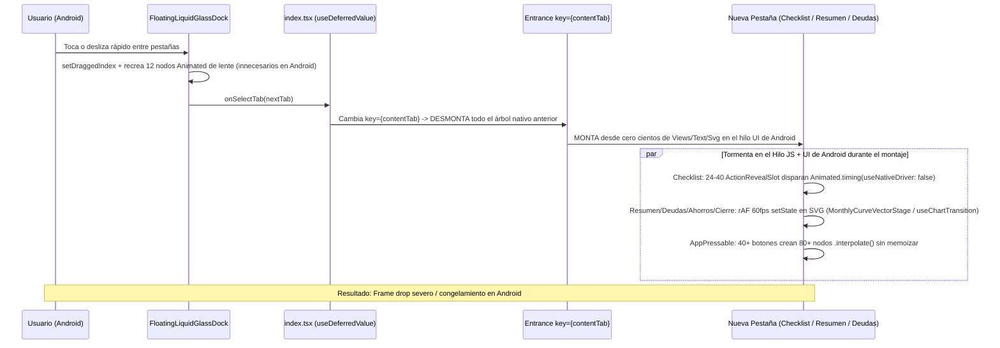

# Auditoría de Preparación para Producción y Publicación — BFlow

> [!IMPORTANT]
> **Auditoría 100% Basada en Evidencia Real (Cero Suposiciones):** Todos los hallazgos de este documento fueron verificados directamente sobre el código fuente actual, las reglas de Firestore, los workflows de GitHub Actions, `npm audit --omit=dev` y la ejecución cronometrada de Jest. **No se modificó ningún archivo del repositorio ni se tocaron los tests de Firebase en curso.**

---

## 1. Resumen Ejecutivo y Matriz de Severidad

| ID | Preocupación / Categoría | Severidad | Hallazgo Principal Confirmado (Evidencia) | Fase |
| :--- | :--- | :--- | :--- | :--- |
| **AUD-01** | **7. Límite de peticiones / Fuerza bruta** | `[CRITICAL]` | **Cero límite de intentos (ej. máx. 5)** y cero *cooldown* en login (`signInWithEmail`), reautenticación de cambio de correo (`requestEmailChange`), reenvío de verificación/recuperación y botón `Sincronizar datos ahora`. Sin Firebase App Check. | **Fase 1** |
| **AUD-02** | **8. Políticas de contraseña (creación y reset)** | `[HIGH]` | Solo se valida `password.length < 6` ([AuthScreen.tsx](file:///c:/Users/D0604763/Documents/BFlow/BFlow/src/features/auth/components/AuthScreen.tsx#L132-L135), [authAdapter.ts](file:///c:/Users/D0604763/Documents/BFlow/BFlow/src/platform/auth/authAdapter.ts#L445-L447)). No exige mayúsculas, minúsculas, números, caracteres especiales ni longitud robusta (≥ 8–10), ni está sincronizado con la política de Firebase Auth para el enlace de restablecimiento. | **Fase 1** |
| **AUD-03** | **4. Seguridad en reglas de Firestore (`email_verified`)** | `[HIGH]` | `isOwner(uid)` en [firestore.rules](file:///c:/Users/D0604763/Documents/BFlow/BFlow/firestore.rules#L51-L53) no valida `request.auth.token.email_verified == true`, y [index.tsx](file:///c:/Users/D0604763/Documents/BFlow/BFlow/src/app/index.tsx#L181-L185) dispara `syncUserCloudAccount` antes del bloqueo visual de `EmailVerificationScreen`. | **Fase 1** |
| **AUD-04** | **4. Criptografía local, PRNG y secretos** | `[CRITICAL]` | 1) `randomBytes()` en [storageCipher.ts](file:///c:/Users/D0604763/Documents/BFlow/BFlow/src/platform/storage/storageCipher.ts#L102-L112) cae en `Math.random()` si no existe `globalThis.crypto.getRandomValues`. 2) En [storageBackend.native.ts](file:///c:/Users/D0604763/Documents/BFlow/BFlow/src/platform/storage/storageBackend.native.ts#L149-L167), si `SecureStore.setItem` falla, guarda el `device_token` en **texto plano** en SQLite junto al texto cifrado. 3) `DEFAULT_BFLOW_FIREBASE_OPTIONS` ([firebaseConfig.ts](file:///c:/Users/D0604763/Documents/BFlow/BFlow/src/data/firebase/firebaseConfig.ts#L33-L40)), `DEFAULT_APPLICATION_PEPPER` ([storageCipher.ts](file:///c:/Users/D0604763/Documents/BFlow/BFlow/src/platform/storage/storageCipher.ts#L18-L19)) y PII del propietario (`abernalg2303@gmail.com` en [authAdapter.ts](file:///c:/Users/D0604763/Documents/BFlow/BFlow/src/platform/auth/authAdapter.ts#L67-L75)) están hardcodeados en el bundle. | **Fase 2** |
| **AUD-05** | **4. Vulnerabilidades en dependencias (`npm audit`)** | `[HIGH]` | `npm audit --omit=dev` reporta **18 vulnerabilidades (6 High, 11 Moderate, 1 Low)** incluyendo `zod < 4.6.6` (GHSA-mrhx-c7xc-m3w5, agotamiento de memoria), `@grpc/grpc-js <= 1.13.5` (en `firebase`) y `@xmldom/xmldom` (en `@bacons/apple-targets`). | **Fase 2** |
| **AUD-06** | **3. Trabas/lag en Android al cambiar rápido de ventana** | `[CRITICAL]` | **5 causas raíz combinadas en Android:** 1) Desmontaje y montaje total de la jerarquía nativa (`<Entrance key={contentTab}>` en [index.tsx](file:///c:/Users/D0604763/Documents/BFlow/BFlow/src/app/index.tsx#L494-L511)). 2) `ActionRevealSlot` ([ChecklistWorkspaceView.tsx](file:///c:/Users/D0604763/Documents/BFlow/BFlow/src/features/checklist/components/ChecklistWorkspaceView.tsx#L128-L149)) dispara **24–40 animaciones `useNativeDriver: false`** al montar `ChecklistTab` aunque `visible={false}`. 3) Bucles `requestAnimationFrame` + `setState` a 60fps en hilo JS al montar la curva vectorial ([MonthlyCurveVectorStage.tsx](file:///c:/Users/D0604763/Documents/BFlow/BFlow/src/features/summary/components/MonthlyCurveVectorStage.tsx#L100-L141)) y gráficas ([useChartTransition.ts](file:///c:/Users/D0604763/Documents/BFlow/BFlow/src/design-system/components/charts/useChartTransition.ts#L46-L52)). 4) `AppPressable` ([AppPressable.tsx](file:///c:/Users/D0604763/Documents/BFlow/BFlow/src/design-system/components/AppPressable.tsx#L218-L325)) recrea nodos `.interpolate()` en cada render. 5) `FloatingLiquidGlassDock` ([FloatingLiquidGlassDock.tsx](file:///c:/Users/D0604763/Documents/BFlow/BFlow/src/design-system/components/FloatingLiquidGlassDock.tsx#L279-L606)) re-renderiza y construye 12 nodos de lente en Android aunque no usa lente. | **Fase 3** |
| **AUD-07** | **1 y 2. Rendimiento general y optimización de procesos** | `[HIGH]` | 1) `loadFullCloudAccount` ([budgetRepository.ts](file:///c:/Users/D0604763/Documents/BFlow/BFlow/src/data/repositories/budgetRepository.ts#L1260-L1268)) descarga **toda la historia sin límite** de `entries` y `debtPayments` cuando cambia `dataRevision`. 2) Cifrado AES-256-CTR + HMAC-SHA256 en bucles JS puros síncronos en el hilo principal ([storageCipher.ts](file:///c:/Users/D0604763/Documents/BFlow/BFlow/src/platform/storage/storageCipher.ts#L141-L415)). 3) `MonthlyCurveStageLoader.tsx` ([MonthlyCurveStageLoader.tsx](file:///c:/Users/D0604763/Documents/BFlow/BFlow/src/features/summary/components/MonthlyCurveStageLoader.tsx#L1)) importa `three` (`0.187.0`) estáticamente en Android aunque Android nunca usa WebGL 3D. 4) `triggerWidgetSync` ([sliceTypes.ts](file:///c:/Users/D0604763/Documents/BFlow/BFlow/src/features/budget/store/slices/sliceTypes.ts#L383-L417)) recalcula y serializa el snapshot en 57 puntos antes de comparar equivalencia. 5) `isEquivalentCloudAccount` ([accountCache.ts](file:///c:/Users/D0604763/Documents/BFlow/BFlow/src/platform/storage/accountCache.ts#L66-L94)) ejecuta hasta 8 `JSON.stringify`. 6) Estados de formularios inline sin aislar en Deudas, Ahorros y Cuenta. 7) Íconos PNG sin comprimir (3,47 MB entre `icon.png` y `adaptive-icon.png`). | **Fase 4** |
| **AUD-08** | **5. Tiempos de ejecución de tests (Jest)** | `[MEDIUM]` | Ejecución medida hoy: **194,31 s (~3 min 14 s)** para 69 suites (879 tests). `vectorCurve.test.tsx` toma **189,26 s** (ejecuta `jest.advanceTimersByTime(10_000)` 11 veces = ~5.060 re-renders SVG), seguido por `workspacePlatforms.test.tsx` (160,39 s), `renderCommits.test.tsx` (148,70 s) y `designSystem.test.tsx` (134,12 s). Falta ajuste de `maxWorkers`, caché de transformación y salto rápido de animaciones en tests que no evalúan frames intermedios. | **Fase 5** |
| **AUD-09** | **6. Tiempos de compilado `.ipa` y `.apk` en GitHub Actions** | `[HIGH]` | 1) **Bug crítico de caché en iOS:** En [build-ios.yml](file:///c:/Users/D0604763/Documents/BFlow/BFlow/.github/workflows/build-ios.yml#L78-L86), `/ios` está en `.gitignore` y `expo prebuild --no-install` **no genera `Podfile.lock`**, por lo que `hashFiles('ios/Podfile.lock')` evalúa a vacío (`""`) antes de `pod install`. 2) **Triple ejecución de tests en `main`:** `ci.yml`, `build-ios.yml` y `build-android.yml` corren el mismo `quality-gate` por separado en cada push. 3) **Doble arranque de Gradle y 4 ABIs en Android:** [build-android.yml](file:///c:/Users/D0604763/Documents/BFlow/BFlow/.github/workflows/build-android.yml#L78-L85) lanza dos procesos `--no-daemon` separados (`assembleRelease` y luego `bundleRelease`) compilando las 4 arquitecturas (`armeabi-v7a`, `arm64-v8a`, `x86`, `x86_64`). 4) Sin `ccache` en `xcodebuild`. | **Fase 6** |

---

## 2. Diagnóstico Detallado por Punto (Con Evidencia de Código)

### Punto 1 y 2: Rendimiento en General y Optimización de Procesos

1. **Lecturas sin cota en `loadFullCloudAccount` ([budgetRepository.ts](file:///c:/Users/D0604763/Documents/BFlow/BFlow/src/data/repositories/budgetRepository.ts#L1260-L1268)):**
   - Mientras el atajo `R-13` (líneas 1232–1248) ahorra lecturas cuando `dataRevision` coincide, cualquier cambio desde otro dispositivo, vencimiento de las 24h de caché o toque en "Sincronizar datos ahora" descarga las colecciones `entries` y `debtPayments` completas sin filtro `where('monthKey', '>=', ...)`. Con 36–60 meses de historial, una sola sincronización lee entre 500 y 800 documentos y reconstruye en bucle todos los meses en memoria (líneas 1723–1942).
2. **Cifrado AES-256-CTR + HMAC-SHA256 en JavaScript puro síncrono sobre el hilo UI/JS ([storageCipher.ts](file:///c:/Users/D0604763/Documents/BFlow/BFlow/src/platform/storage/storageCipher.ts#L141-L415)):**
   - `encryptStoragePayload` y `decryptStoragePayload` ejecutan `sha256`, `expandAes256Key`, `aes256CtrTransform` byte por byte, conversión hexadecimal y `hmacSha256` sobre toda la cadena en el hilo JS principal antes de llamar a `sqlite.setItemSync` ([storageBackend.native.ts](file:///c:/Users/D0604763/Documents/BFlow/BFlow/src/platform/storage/storageBackend.native.ts#L81-L86)). Aunque `schedulePersistedAccountSave` tiene un debounce de 300ms ([accountCache.ts](file:///c:/Users/D0604763/Documents/BFlow/BFlow/src/platform/storage/accountCache.ts#L179-L195)), cuando el timer dispara o la cola offline encola una operación ([offlineWriteQueue.ts](file:///c:/Users/D0604763/Documents/BFlow/BFlow/src/platform/storage/offlineWriteQueue.ts#L76-L83)), bloquea síncronamente el hilo JS.
3. **Carga innecesaria de `three.js` (`0.187.0`) en el bundle de Android ([MonthlyCurveStageLoader.tsx](file:///c:/Users/D0604763/Documents/BFlow/BFlow/src/features/summary/components/MonthlyCurveStageLoader.tsx#L1)):**
   - `MonthlyCurveStageLoader.tsx` exporta estáticamente `MonthlyCurveStage`, que importa `MonthlyCurveScene` y `three`. Aunque Android usa exclusivamente `MonthlyCurveVectorStage` (`skinSpec.curveStage === 'vector'` en [MonthlyCurveSection.tsx](file:///c:/Users/D0604763/Documents/BFlow/BFlow/src/features/summary/components/MonthlyCurveSection.tsx#L335)), Hermes en Android parsea y evalúa `three` y `expo-gl` en el arranque. Separar `MonthlyCurveStageLoader.ios.tsx` y `MonthlyCurveStageLoader.android.tsx` (noop igual que `.web.tsx`) elimina `three` por completo del grafo de módulos de Android.
4. **Cálculo y serialización redundante en `triggerWidgetSync` ([sliceTypes.ts](file:///c:/Users/D0604763/Documents/BFlow/BFlow/src/features/budget/store/slices/sliceTypes.ts#L383-L417) y [widgetAdapter.native.ts](file:///c:/Users/D0604763/Documents/BFlow/BFlow/src/platform/widgets/widgetAdapter.native.ts#L106-L115)):**
   - Invocado en 57 sitios del store. En cada llamada ejecuta `buildWidgetSnapshot` (que corre calculadores de dominio e historial de tendencias) y luego en `widgetAdapter.native.ts:107` ejecuta `serializeWidgetSnapshot(snapshot)` (`JSON.stringify`) **antes** de verificar `isEquivalentWidgetSnapshot(latestSnapshot, snapshot)` en la línea 112.
5. **Formularios con estado de texto no aislado en vistas grandes:**
   - En [DebtsFunfamiView.tsx](file:///c:/Users/D0604763/Documents/BFlow/BFlow/src/features/debts/components/DebtsFunfamiView.tsx#L89-L100), [SavingsAndMotoIdealView.tsx](file:///c:/Users/D0604763/Documents/BFlow/BFlow/src/features/savings/components/SavingsAndMotoIdealView.tsx#L268-L290) y [AccountProfileWorkspaceView.tsx](file:///c:/Users/D0604763/Documents/BFlow/BFlow/src/features/auth/components/AccountProfileWorkspaceView.tsx#L85-L105), los `useState` de cada `AppTextInput` viven en el componente padre de toda la pestaña. Cada tecla pulsada re-renderiza todas las tarjetas, gráficas y listas de la pantalla.

---

### Punto 3: Por Qué en Android se Traba o Hay Delay al Cambiar Rápidamente de Ventanas

La auditoría del árbol de navegación y renderizado en Android identificó **5 cuellos de botella exactos** que ocurren simultáneamente cuando el usuario toca varias pestañas seguidas en el dock de Android:



1. **Destrucción y recreación completa de la vista nativa en cada cambio (`key={contentTab}` en [index.tsx](file:///c:/Users/D0604763/Documents/BFlow/BFlow/src/app/index.tsx#L494-L511)):**
   - `index.tsx` renderiza `<Entrance key={contentTab} kind="screen">` con renderizado condicional (`{contentTab === 'summary' ? <SummaryTab /> : null}`, etc.). En Android, desmontar una jerarquía completa de React Native y montar otra con decenas de `GlassSurface`, `Svg` y `AppPressable` dentro de un único `KeyboardAwareScrollView` fuerza al UI Thread de Android (`ViewGroup.removeView` / `addView` + pase de Yoga layout) a reconstruir toda la pantalla en cada toque.
2. **Bug en `ActionRevealSlot`: 24 a 40 animaciones JS (`useNativeDriver: false`) disparadas al montar `ChecklistTab` ([ChecklistWorkspaceView.tsx](file:///c:/Users/D0604763/Documents/BFlow/BFlow/src/features/checklist/components/ChecklistWorkspaceView.tsx#L128-L149)):**
   - Cada fila del checklist monta 2 `<ActionRevealSlot>` (`visible={isEditMode}` y `visible={isDeleteMode}`). En su `useEffect` (líneas 128–149), cuando `visible` es `false` en el primer render (`mounted === false`), ¡no hay un `if (!mounted) return;`! Por tanto, al entrar a `ChecklistTab`, **cada fila ejecuta `Animated.timing(progress, { toValue: 0, duration: close.durationMs, useNativeDriver: false }).start(...)`**. Con 15 movimientos, **30 animaciones de layout en el hilo JS** arrancan al mismo tiempo en el instante del cambio de pestaña.
3. **Bucles `requestAnimationFrame` + `setState` a 60fps en SVG justo durante el montaje de la pestaña:**
   - En [MonthlyCurveVectorStage.tsx](file:///c:/Users/D0604763/Documents/BFlow/BFlow/src/features/summary/components/MonthlyCurveVectorStage.tsx#L100-L141) (`useAnimatedFrame`) y [MonthlyCurveSection.tsx](file:///c:/Users/D0604763/Documents/BFlow/BFlow/src/features/summary/components/MonthlyCurveSection.tsx#L81-L117) (`useTweenedAmount`), apenas `SummaryTab` mide su layout en Android, arrancan dos bucles `requestAnimationFrame` haciendo `setState` cada 16ms en el hilo JS (recalculando strings `<Path d="...">` y re-renderizando todo el SVG durante 7,4 segundos).
   - De igual forma, al entrar a `DebtsTab`, `SavingsTab` o `AnalyticsTab`, [useChartTransition.ts](file:///c:/Users/D0604763/Documents/BFlow/BFlow/src/design-system/components/charts/useChartTransition.ts#L46-L52) ejecuta `useReducer` (`redraw()`) en cada `requestAnimationFrame` durante la animación de entrada de la pestaña (`Entrance`), compitiendo por el hilo JS mientras Android intenta terminar de montar la vista.
4. **Creación no memoizada de `.interpolate()` en cada `AppPressable` ([AppPressable.tsx](file:///c:/Users/D0604763/Documents/BFlow/BFlow/src/design-system/components/AppPressable.tsx#L218-L325)):**
   - En Android (`sinksOnPress === true`), `AnimatedPressable` llama a `buildSinkPressStyle(pressProgress, spec)` en cada render, ejecutando `pressProgress.interpolate(...)` dos veces por botón sin `useRef`/`useMemo`, además de `StyleSheet.flatten(style)`.
5. **Nodos `Animated` de lente iOS creados innecesariamente en Android dentro de `FloatingLiquidGlassDock` ([FloatingLiquidGlassDock.tsx](file:///c:/Users/D0604763/Documents/BFlow/BFlow/src/design-system/components/FloatingLiquidGlassDock.tsx#L543-L606)):**
   - En la línea 606, `const lensGeometry = buildLensGeometry(...)` se ejecuta en **cada render** incluso cuando `isLiquidGlass === false` (Android), instanciando 12 nodos `Animated.multiply/add/subtract/interpolate` que nunca se usan porque Android renderiza la píldora plana (`testID="dock-flat-indicator"`).

---

### Punto 4: Seguridad, Variables de Entorno, API Keys, Datos Sensibles y Criptografía

1. **PRNG Inseguro (`Math.random()`) como fallback en `storageCipher.ts` ([storageCipher.ts](file:///c:/Users/D0604763/Documents/BFlow/BFlow/src/platform/storage/storageCipher.ts#L102-L112)):**
   - `randomBytes()` intenta usar `globalThis.crypto.getRandomValues`. Si en algún entorno nativo Hermes no está expuesto globalmente, cae silenciosamente en `Date.now()` + `Math.random()` pasado por SHA-256 para generar tanto el `deviceSecretToken` de 256 bits como los IVs de AES-256-CTR. Debe usar el CSPRNG nativo de `expo-crypto` (`getRandomBytes`) o fallar de forma explícita.
2. **Fallback silencioso de `SecureStore` a texto plano en SQLite ([storageBackend.native.ts](file:///c:/Users/D0604763/Documents/BFlow/BFlow/src/platform/storage/storageBackend.native.ts#L149-L167)):**
   - En `createNativeStorageBackend()`, cuando `isSecureStoreKey(key)` es `true` (lo cual incluye `bflow.security.device_token.v1`), si `secureStore.setItem(key, value)` lanza una excepción temporal del Keystore/Keychain (líneas 155–160), el bloque `catch` ejecuta `writeFallbackKv(key, value)` guardando la llave maestra `device_token` **en texto plano** dentro de `expo-sqlite/kv-store`, en la misma base de datos donde reside el texto cifrado.
3. **Credenciales de Firebase y Pepper por defecto hardcodeadas en el código fuente:**
   - [firebaseConfig.ts](file:///c:/Users/D0604763/Documents/BFlow/BFlow/src/data/firebase/firebaseConfig.ts#L33-L40) incluye `DEFAULT_BFLOW_FIREBASE_OPTIONS` con el `apiKey` y `projectId` (`bflow-deaeb`) de producción.
   - [storageCipher.ts](file:///c:/Users/D0604763/Documents/BFlow/BFlow/src/platform/storage/storageCipher.ts#L18-L19) incluye `DEFAULT_APPLICATION_PEPPER = 'BFlow-Sovereign-Vault-Pepper-2026#AES256-HMAC-SHA256'`. Además, en Web ([storageBackend.ts](file:///c:/Users/D0604763/Documents/BFlow/BFlow/src/platform/storage/storageBackend.ts#L18-L45)), el `device_token` y los datos cifrados viven juntos en `window.localStorage`: ante un XSS en Web, ambos son legibles por script. En Web la sesión o el token no deben persistir datos financieros sensibles en `localStorage` permanente sin advertencia o clave derivada de sesión en memoria (`sessionStorage` / WebCrypto `CryptoKey` no exportable en `IndexedDB`).
   - [authAdapter.ts](file:///c:/Users/D0604763/Documents/BFlow/BFlow/src/platform/auth/authAdapter.ts#L67-L75) y [budgetRepository.ts](file:///c:/Users/D0604763/Documents/BFlow/BFlow/src/data/repositories/budgetRepository.ts#L254-L257) exponen el correo personal del autor (`abernalg2303@gmail.com`) en el bundle de producción.
4. **Reglas de Firestore y `email_verified` ([firestore.rules](file:///c:/Users/D0604763/Documents/BFlow/BFlow/firestore.rules#L51-L53)):**
   - `isOwner(uid)` solo valida `request.auth != null && request.auth.uid == uid`. Cualquier cuenta creada con correo/contraseña aún no verificada puede leer y escribir en Firestore directamente (y de hecho la app llama a `syncUserCloudAccount` en [index.tsx](file:///c:/Users/D0604763/Documents/BFlow/BFlow/src/app/index.tsx#L181-L185) antes de que el usuario verifique su correo).

---

### Punto 5: Tiempos de Ejecución de Tests

En la medición real ejecutada en este entorno (`69 suites`, `879 tests`), el tiempo total fue de **194,313 s (~3,2 minutos)**. Las 10 suites más lentas son:

| Suite de Test | Tiempo Medido | Causa Raíz |
| :--- | :--- | :--- |
| [vectorCurve.test.tsx](file:///c:/Users/D0604763/Documents/BFlow/BFlow/src/features/summary/__tests__/vectorCurve.test.tsx) | **189,26 s** | Llama 11 veces a `elapse(10_000)` con `jest.advanceTimersByTime(10_000)`, disparando ~5.060 frames `requestAnimationFrame` y ~5.060 re-renders completos de `<Svg>` en RNTL. |
| [workspacePlatforms.test.tsx](file:///c:/Users/D0604763/Documents/BFlow/BFlow/src/features/shell/__tests__/workspacePlatforms.test.tsx) | **160,39 s** | Monta la app completa (`PhaseOneHomeScreen`) 42 veces (3 pieles × múltiples anchos y flujos completos) incluyendo gráficas animadas. |
| [renderCommits.test.tsx](file:///c:/Users/D0604763/Documents/BFlow/BFlow/src/features/__tests__/renderCommits.test.tsx) | **148,70 s** | Monta la app completa en las 3 pieles y navega por todas las pestañas midiendo commits. |
| [designSystem.test.tsx](file:///c:/Users/D0604763/Documents/BFlow/BFlow/src/design-system/__tests__/designSystem.test.tsx) | **134,12 s** | Monta `PhaseOneHomeScreen` completo junto con pruebas unitarias de componentes pequeños. |
| [savingsAndMotoIdealView.test.tsx](file:///c:/Users/D0604763/Documents/BFlow/BFlow/src/features/savings/components/__tests__/savingsAndMotoIdealView.test.tsx) | **101,32 s** | 24 renders de vista completa (3 pieles × 8 escenarios interactivos con gráficas). |
| [accountProfileWorkspaceView.test.tsx](file:///c:/Users/D0604763/Documents/BFlow/BFlow/src/features/auth/__tests__/accountProfileWorkspaceView.test.tsx) | **99,10 s** | 21 tests montando `AccountProfileWorkspaceView` completo con animaciones de entrada. |
| [debtsFunfamiView.test.tsx](file:///c:/Users/D0604763/Documents/BFlow/BFlow/src/features/debts/components/__tests__/debtsFunfamiView.test.tsx) | **89,13 s** | 12 tests de vista completa en las 3 pieles con `DebtTrendChart`. |
| [savingsTrendCharts.test.tsx](file:///c:/Users/D0604763/Documents/BFlow/BFlow/src/features/savings/components/__tests__/savingsTrendCharts.test.tsx) | **85,59 s** | Transformación inicial de Babel en workers saturados + montaje de gráficas SVG. |
| [adaptiveSelectField.test.tsx](file:///c:/Users/D0604763/Documents/BFlow/BFlow/src/design-system/__tests__/adaptiveSelectField.test.tsx) | **77,03 s** | Contención de CPU entre workers de Jest en Windows (el primer test tarda 19.085 ms solo esperando CPU/transform). |
| [phase4Screens.test.tsx](file:///c:/Users/D0604763/Documents/BFlow/BFlow/src/features/__tests__/phase4Screens.test.tsx) | **67,72 s** | 6 flujos E2E pesados montando toda la aplicación. |

---

### Punto 6: Tiempos de Compilado de `.ipa` y `.apk` en GitHub Actions

1. **Caché de CocoaPods rota en [build-ios.yml](file:///c:/Users/D0604763/Documents/BFlow/BFlow/.github/workflows/build-ios.yml#L78-L90):**
   - La carpeta `/ios` está en [.gitignore](file:///c:/Users/D0604763/Documents/BFlow/BFlow/.gitignore#L13).
   - En la línea 78 se ejecuta `npx expo prebuild --platform ios --clean --no-install`. Como tiene `--no-install`, Expo genera `ios/Podfile` pero **no ejecuta `pod install`**, por lo que **`ios/Podfile.lock` no existe** cuando se evalúa el paso `Cache CocoaPods` en la línea 80 (`hashFiles('ios/Podfile.lock')` devuelve `""`).
   - Además, `xcodebuild` (líneas 97–106) compila todos los pods nativos (React Native, Reanimated, Expo) desde cero sin `ccache` (`USE_CCACHE=1` / `CCACHE_DIR`).
2. **Doble invocación de Gradle con `--no-daemon` y 4 arquitecturas en [build-android.yml](file:///c:/Users/D0604763/Documents/BFlow/BFlow/.github/workflows/build-android.yml#L78-L85):**
   - El paso `Build release APK` ejecuta `./gradlew assembleRelease --no-daemon` (arranca JVM, compila 4 arquitecturas `armeabi-v7a,arm64-v8a,x86,x86_64`, corre R8 y mata la JVM).
   - El paso siguiente `Build Play Store AAB` vuelve a ejecutar `./gradlew bundleRelease --no-daemon` (arranca una nueva JVM desde cero y repite el grafo de tareas y R8).
   - Unificar ambos en un solo comando `./gradlew assembleRelease bundleRelease` con caché de configuración/build de Gradle y limitar `reactNativeArchitectures=arm64-v8a` cuando solo se requiere APK de prueba reduce drásticamente el tiempo.
3. **Triple ejecución del `quality-gate` en cada push a `main`:**
   - [ci.yml](file:///c:/Users/D0604763/Documents/BFlow/BFlow/.github/workflows/ci.yml#L3-L7), [build-ios.yml](file:///c:/Users/D0604763/Documents/BFlow/BFlow/.github/workflows/build-ios.yml#L3-L11) y [build-android.yml](file:///c:/Users/D0604763/Documents/BFlow/BFlow/.github/workflows/build-android.yml#L3-L11) se disparan al mismo tiempo en `push` a `main`, corriendo 3 veces `npm ci` + `typecheck` + `lint` + `npm test -- --coverage`.

---

### Punto 7 y 8: Límite de Peticiones (Rate Limiting / 5 Intentos) y Seguridad de Contraseñas

1. **Ausencia de límite de 5 intentos y bloqueo temporal (Lockout) en contraseñas:**
   - Ni el inicio de sesión ([AuthScreen.tsx](file:///c:/Users/D0604763/Documents/BFlow/BFlow/src/features/auth/components/AuthScreen.tsx#L151-L157) / [authAdapter.ts](file:///c:/Users/D0604763/Documents/BFlow/BFlow/src/platform/auth/authAdapter.ts#L422-L431)) ni la reautenticación por contraseña actual al cambiar de correo ([AccountProfileWorkspaceView.tsx](file:///c:/Users/D0604763/Documents/BFlow/BFlow/src/features/auth/components/AccountProfileWorkspaceView.tsx#L178-L212) / [accountEmailActions.ts](file:///c:/Users/D0604763/Documents/BFlow/BFlow/src/platform/auth/accountEmailActions.ts#L74-L104)) llevan un contador persistente de intentos fallidos. Un atacante o usuario puede enviar intentos ilimitados hasta que Firebase dispare `auth/too-many-requests`.
2. **Ausencia de *cooldown* (60s) en envío de correos y sincronización manual:**
   - Los botones de "Enviar enlace" (recuperar contraseña), "Reenviar correo de verificación" ([EmailVerificationScreen.tsx](file:///c:/Users/D0604763/Documents/BFlow/BFlow/src/features/auth/components/EmailVerificationScreen.tsx#L101-L121)) y "Sincronizar datos ahora" ([index.tsx](file:///c:/Users/D0604763/Documents/BFlow/BFlow/src/app/index.tsx#L382-L387), que fuerza `forceFullSync: true` leyendo toda la base de datos) se pueden pulsar repetidamente en cuanto termina la promesa (~300ms), permitiendo agotar la cuota gratuita de Firebase Auth y las 50.000 lecturas diarias de Firestore Spark.
3. **Política débil de creación y restablecimiento de contraseña:**
   - En [AuthScreen.tsx](file:///c:/Users/D0604763/Documents/BFlow/BFlow/src/features/auth/components/AuthScreen.tsx#L132-L135) y [authAdapter.ts](file:///c:/Users/D0604763/Documents/BFlow/BFlow/src/platform/auth/authAdapter.ts#L445-L447), la única validación es `password.length < 6`. No valida longitud mínima segura (ej. ≥ 8 caracteres), mayúscula (`[A-Z]`), minúscula (`[a-z]`), número (`[0-9]`) ni carácter especial (`[^A-Za-z0-9\s]`), ni muestra un checklist visual en vivo al crear la cuenta.
   - Además, como el restablecimiento usa el enlace alojado por Firebase (`sendPasswordResetEmail`), es indispensable activar la misma política de contraseñas en **Firebase Console → Authentication → Settings → Password policy** (requiere Firebase Auth con Identity Platform o validación en consola) para que el formulario web de Firebase exija exactamente los mismos requisitos al restablecer.

---

## 3. Plan de Implementación por Fases y Prompts Específicos

Cada fase está diseñada para ejecutarse de forma independiente y segura cumpliendo la **Definición de Terminado (`AGENTS.md` §4)**. Copia y pega el prompt de cada fase cuando desees implementarla.

---

### Fase 1: Seguridad de Autenticación, Políticas de Contraseña, Límite de 5 Intentos y Throttling de Servicios

**Objetivo:** Implementar la política estricta de contraseñas (creación y guía de consola para reset), el límite máximo de **5 intentos fallidos de contraseña** con bloqueo temporal persistente, *cooldowns* anti-abuso en envíos de correo y sincronización manual, y la exigencia de correo verificado antes de sincronizar Firestore.

#### Prompt para implementar la Fase 1:
```markdown
Actúa coordinando los roles de Architect, UI Builder, Security Auditor, QA Engineer y Documentation Expert según `AGENTS.md`. Apóyate en las skills `/security-audit`, `/clean-code` y `/write-tests-for-change`.

Implementa la **Fase 1 de la Auditoría de Producción (Políticas de Contraseña, Límite de 5 Intentos, Rate Limiting de Servicios y Verificación de Correo)** sobre hechos verificados:

1. **Política Estricta de Contraseña (`src/domain/auth/passwordPolicy.ts` o helper puro + `src/platform/auth/authAdapter.ts` + `src/features/auth/components/AuthScreen.tsx`):**
   - Crea un validador determinístico reutilizable que exija al registrar cuenta:
     - Mínimo 8 caracteres (máximo 128).
     - Al menos 1 letra mayúscula (`[A-Z]`).
     - Al menos 1 letra minúscula (`[a-z]`).
     - Al menos 1 número (`[0-9]`).
     - Al menos 1 carácter especial (`[!@#$%^&*()_+\-=\[\]{};':"\\|,.<>\/?~`]`).
     - Sin espacios al inicio o al final.
   - En `AuthScreen.tsx` (modo `register`), muestra indicadores claros de cumplimiento de los requisitos de contraseña en las 3 pieles (`ios`, `android`, `web`) usando únicamente tokens de `useBFlowTheme()` y `AppPressable`.
   - En `authAdapter.ts` (`registerWithEmail`), aplica la misma validación antes de invocar a Firebase Auth.

2. **Límite de 5 Intentos de Contraseña y Bloqueo Temporal Persistente (`src/platform/auth/authRateLimiter.ts` + `authAdapter.ts` + `accountEmailActions.ts` + UI):**
   - Crea un limitador de intentos persistido en almacenamiento cifrado (`persistentStorageAdapter`) por acción (`login_password` y `reauth_email_change`):
     - Permite máximo **5 intentos fallidos consecutivos** por credenciales inválidas (`auth/invalid-credential`, `auth/wrong-password`, `auth/invalid-login-credentials`).
     - Al alcanzar el 5.º intento fallido, bloquea nuevos intentos durante **15 minutos** (mostrando al usuario cuántos intentos le quedan del 1 al 4 y, al bloquearse, el tiempo restante en minutos/segundos y la opción de restablecer su contraseña por correo).
     - Al iniciar sesión o reautenticarse con éxito, reinicia el contador a `0`.
   - Integra este limitador en `signInWithEmail` (`AuthScreen.tsx` / `authAdapter.ts`) y en `requestEmailChange` (`AccountProfileWorkspaceView.tsx` / `accountEmailActions.ts`).

3. **Cooldowns Anti-Abuso en Correos y Sincronización Manual:**
   - Añade un *cooldown* de **60 segundos** (con contador visual en el botón deshabilitado) tras enviar:
     - Enlace de recuperación de contraseña (`sendPasswordResetLink` en `AuthScreen.tsx` y `AccountProfileWorkspaceView.tsx`).
     - Correo de verificación (`sendVerificationEmail` en `EmailVerificationScreen.tsx` y `AccountProfileWorkspaceView.tsx`).
   - Añade un *cooldown* de **30 segundos** al botón `Sincronizar datos ahora` (`handleManualSync` en `src/app/index.tsx` / `AccountProfileWorkspaceView.tsx`) para impedir lecturas masivas repetidas (`forceFullSync: true`) contra Firestore Spark.

4. **Protección de Firestore para Cuentas No Verificadas (`src/app/index.tsx` y `firestore.rules`):**
   - En `src/app/index.tsx`, no dispares `syncUserCloudAccount` mientras `requiresEmailVerification(authUser)` sea `true` (evita lecturas/escrituras de presupuesto antes de verificar el correo).
   - Delega al subagente `firestore-rules-author` (o actualiza `firestore.rules` siguiendo `AGENTS.md`) la evaluación/endurecimiento de `users/{uid}` frente a cuentas sin verificar manteniendo compatibilidad con los flujos existentes, y documenta en una guía `docs/guides/` cómo activar la **Password Policy** y **Firebase App Check** en Firebase Console.

5. **Definition of Done (`AGENTS.md` §4):**
   - Añade tests unitarios y de componente en las 3 pieles (`ios`, `android`, `web`) para la política de contraseñas, el bloqueo al 5.º intento fallido y los *cooldowns*.
   - Ejecuta `npm run typecheck`, `npm run lint`, `node scripts/check-src-tests-guard.mjs` y los tests afectados verificando 0 errores.
```

---

### Fase 2: Endurecimiento Criptográfico, Variables de Entorno, Limpieza de PII y Dependencias

**Objetivo:** Eliminar el fallback inseguro `Math.random()` en criptografía, impedir que `SecureStore` caiga en texto plano en SQLite, usar variables de entorno sin exponer PII del propietario ni secretos hardcodeados, y mitigar las vulnerabilidades de `npm audit`.

#### Prompt para implementar la Fase 2:
```markdown
Actúa coordinando los roles de Architect, Security Auditor, QA Engineer, Reviewer y Documentation Expert según `AGENTS.md`. Apóyate en las skills `/security-audit`, `/clean-code` y `/write-tests-for-change`.

Implementa la **Fase 2 de la Auditoría de Producción (Criptografía CSPRNG, Aislamiento de SecureStore, Variables de Entorno, PII y Vulnerabilidades de Dependencias)**:

1. **CSPRNG Estricto en `src/platform/storage/storageCipher.ts`:**
   - Elimina el fallback inseguro basado en `Math.random()` y `Date.now()` dentro de `randomBytes()` (líneas 102–112).
   - Usa `globalThis.crypto.getRandomValues` o el generador criptográfico nativo de Expo/WebCrypto; si ningún CSPRNG seguro está disponible en el entorno de ejecución, lanza un error explícito en lugar de generar llaves o IVs predecibles.

2. **Fail-Closed en `SecureStore` Nativo (`src/platform/storage/storageBackend.native.ts`) y Aislamiento en Web (`src/platform/storage/storageBackend.ts`):**
   - En `storageBackend.native.ts` (líneas 149–167), cuando `isSecureStoreKey(key)` sea `true` (como `bflow.security.device_token.v1`), **prohíbe** que un fallo de `secureStore.setItem` escriba el token en texto plano dentro de `expo-sqlite/kv-store` (`writeFallbackKv`). Mantén el token únicamente en memoria para la sesión activa si el Keystore/Keychain falla temporalmente.
   - En Web (`storageBackend.ts`), separa el almacenamiento de `bflow.security.device_token.v1` para que no resida en el mismo `localStorage` permanente junto al ciphertext (utilizando `sessionStorage` para el token de sesión del dispositivo en navegador).

3. **Variables de Entorno, Configuración Firebase y Desacoplamiento de PII:**
   - En `src/data/firebase/firebaseConfig.ts`, elimina las credenciales de producción hardcodeadas en `DEFAULT_BFLOW_FIREBASE_OPTIONS` para que en producción se lean estrictamente de `EXPO_PUBLIC_FIREBASE_*` (conservando un mock seguro exclusivamente cuando `process.env.NODE_ENV === 'test'` o `isDemoModeEnabled()`).
   - Revisa las referencias hardcodeadas a `abernalg2303@gmail.com` en `src/platform/auth/authAdapter.ts` y `src/data/repositories/budgetRepository.ts`: mueve el correo canónico de seed a una variable de entorno opcional (`EXPO_PUBLIC_OWNER_SEED_EMAIL`) con fallback exclusivo en entorno de test (`NODE_ENV === 'test'`) o modo demo (`isDemoModeEnabled()`), evitando exponer correos personales en builds públicos.
   - Actualiza `.env.example` y `README.md` (`AGENTS.md` §5.3).

4. **Saneamiento de Vulnerabilidades de Dependencias (`package.json`):**
   - Revisa las vulnerabilidades reportadas por `npm audit --omit=dev` (como `zod` a `>=4.6.6` si es compatible con el esquema actual en `src/data/mappers/firestoreSchemas.ts`, o `overrides` seguros en `package.json` para subdependencias como `@xmldom/xmldom` / `@grpc/grpc-js`) verificando que no rompan `typecheck`, `lint` ni tests. Redacta el ADR correspondiente en `docs/decisions/` si se actualiza una librería mayor (`AGENTS.md` §5.2).

5. **Definition of Done (`AGENTS.md` §4):**
   - Actualiza y añade tests unitarios en `src/platform/storage/__tests__/` y `src/data/__tests__/`.
   - Verifica `npm run typecheck`, `npm run lint` y `node scripts/check-src-tests-guard.mjs` con 0 errores.
```

---

### Fase 3: Corrección del Lag/Trabas en Android al Cambiar Rápidamente de Ventanas

**Objetivo:** Eliminar por completo el congelamiento y delay en Android al cambiar rápidamente entre las 6 pestañas del dock.

#### Prompt para implementar la Fase 3:
```markdown
Actúa coordinando los roles de UI Builder, Architect, QA Engineer y Reviewer según `AGENTS.md`. Apóyate en las skills `/react-performance`, `/react-best-practices`, `/liquid-glass-ui` y `/write-tests-for-change`.

Implementa la **Fase 3 de la Auditoría de Producción (Eliminación del Lag en Android al Cambiar Rápidamente de Pestañas)** atacando las 5 causas raíz verificadas:

1. **Eliminar las 24–40 animaciones JS al montar `ChecklistTab` (`src/features/checklist/components/ChecklistWorkspaceView.tsx`):**
   - En `ActionRevealSlot` (líneas 113–150), cuando el componente se monta con `visible === false` y `mounted === false`, **no dispares** `Animated.timing(progress, { toValue: 0, duration: close.durationMs, useNativeDriver: false }).start(...)` en el `useEffect`. Solo ejecuta la animación de cierre cuando transicione de `visible: true` (o `mounted: true`) a `false`.

2. **Evitar Destrucción y Reconstrucción Masiva de Vistas Nativas al Cambiar Rápido de Pestaña (`src/app/index.tsx`):**
   - En `src/app/index.tsx` (líneas 445 y 494–511), reemplaza el patrón que desmonta y destruye todo el árbol nativo en cada cambio (`<Entrance key={contentTab}>` con desmontaje total) por una estrategia de **montaje perezoso con retención de pestañas visitadas (keep-alive / vistas ocultas con `display: 'none'` e `importantForAccessibility="no-hide-descendants"` / `pointerEvents="none"` cuando no están activas)** o diferimiento cancelable que no destruya ni recree desde cero los cientos de nodos nativos de Android al pasar rápido por las pestañas.
   - Asegúrate de que todos los `testID` existentes (`workspace-tab-<id>`, etc.) y la accesibilidad sigan funcionando de forma idéntica en las 3 pieles (`ios`, `android`, `web`) sin duplicar `testID` visibles para los tests de RNTL (puedes usar congelación o desmontaje diferido / keep-alive controlado).

3. **Desacoplar el Arranque de Bucles `requestAnimationFrame` SVG del Frame de Montaje de la Pestaña:**
   - En `src/features/summary/components/MonthlyCurveVectorStage.tsx` (`useAnimatedFrame`), `src/features/summary/components/MonthlyCurveSection.tsx` (`useTweenedAmount`) y `src/design-system/components/charts/useChartTransition.ts`:
     - Usa `InteractionManager.runAfterInteractions` (o un breve aplazamiento en nativo cuando no sea entorno de test) o limita la frecuencia de actualización durante transiciones de pestaña para que el bucle JS de 60fps no compita con el montaje inicial de la jerarquía de vistas en Android.
     - En `MonthlyCurveVectorStage`, detén cualquier `requestAnimationFrame` inmediatamente cuando la pestaña `summary` no sea la pestaña activa.

4. **Memoizar Interpolaciones en `AppPressable` (`src/design-system/components/AppPressable.tsx`):**
   - En `AnimatedPressable` (líneas 218–325), memoiza el estilo interpolado de `buildSinkPressStyle(pressProgress, spec)` con `useMemo` dependiendo únicamente de `[pressProgress, spec.scale, spec.opacity]` y evita reconstruir objetos `.interpolate()` en cada render.

5. **Evitar Trabajo de Lente iOS en el Dock de Android (`src/design-system/components/FloatingLiquidGlassDock.tsx`):**
   - En `FloatingLiquidGlassDock.tsx` (línea 606), calcula `buildLensGeometry` únicamente cuando `isLiquidGlass === true` (iOS), evitando crear 12 nodos `Animated` multiplicadores/interpoladores en Android en cada render, y evita re-renders innecesarios durante el gesto de arrastre si el índice de pestaña bajo el dedo no ha cambiado.

6. **Definition of Done (`AGENTS.md` §4 y §7.5):**
   - Añade/actualiza tests en `src/features/shell/__tests__/workspacePlatforms.test.tsx` y `src/features/__tests__/renderCommits.test.tsx` verificando cambios rápidos consecutivos de pestaña en las 3 pieles (`ios`, `android`, `web`).
   - Actualiza `PERF_BASELINE.md` con las métricas antes/después (`AGENTS.md` §5.3).
   - Ejecuta `npm run typecheck`, `npm run lint`, `node scripts/check-src-tests-guard.mjs` y `npm test`.
```

---

### Fase 4: Optimización de Procesos, Consultas Firestore, Bundle Android y Estado de Formularios

**Objetivo:** Acotar lecturas de Firestore a ventanas de meses, eliminar `three.js` del bundle de Android, optimizar `triggerWidgetSync` e `isEquivalentCloudAccount`, aislar el estado de formularios en Deudas/Ahorros/Cuenta y comprimir los assets PNG.

#### Prompt para implementar la Fase 4:
```markdown
Actúa coordinando los roles de Architect, UI Builder, QA Engineer y Documentation Expert según `AGENTS.md`. Apóyate en las skills `/react-performance`, `/react-best-practices`, `/firebase-firestore-modeling`, `/clean-code` y `/write-tests-for-change`.

Implementa la **Fase 4 de la Auditoría de Producción (Optimización de Procesos, Firestore, Bundle Android, Widgets y Formularios)**:

1. **Excluir `three.js` del Bundle Nativo de Android (`src/features/summary/components/MonthlyCurveStageLoader*`):**
   - Actualmente `MonthlyCurveStageLoader.tsx` importa estáticamente `MonthlyCurveStage` -> `MonthlyCurveScene` -> `three`, haciendo que Android parsee `three.js` aunque Android siempre usa `skinSpec.curveStage === 'vector'`.
   - Convierte `MonthlyCurveStageLoader.android.tsx` en un componente nulo liviano (igual que `MonthlyCurveStageLoader.web.tsx`), dejando la carga de `MonthlyCurveStage` exclusivamente en `MonthlyCurveStageLoader.ios.tsx` (y `MonthlyCurveStageLoader.tsx` como fallback tipado para TypeScript).

2. **Aislar Estados de Formularios para Evitar Re-renders de Pantalla Completa al Escribir:**
   - En `src/features/debts/components/DebtsFunfamiView.tsx`, `src/features/savings/components/SavingsAndMotoIdealView.tsx` y `src/features/auth/components/AccountProfileWorkspaceView.tsx`, extrae los formularios de creación/edición (y sus `useState` de texto/monto) en subcomponentes memoizados (`React.memo`) al igual que se hizo en `ChecklistWorkspaceView` (R-17), para que teclear en un `AppTextInput` solo re-renderice el formulario activo y nunca la lista de tarjetas ni las gráficas.

3. **Optimizar `triggerWidgetSync` y `isEquivalentCloudAccount`:**
   - En `src/platform/widgets/widgetAdapter.native.ts` (líneas 106–115), evalúa `isEquivalentWidgetSnapshot(latestSnapshot, snapshot)` **antes** de ejecutar `serializeWidgetSnapshot(snapshot)` para ahorrar validaciones Zod y serializaciones en cada mutación.
   - En `src/features/budget/store/slices/sliceTypes.ts` (`triggerWidgetSync`), aplica un micro-debounce (o coalescencia en el mismo tick/frame) para que múltiples actualizaciones seguidas del store no recalculen `buildWidgetSnapshot` repetidamente.
   - En `src/platform/storage/accountCache.ts` (`isEquivalentCloudAccount`), compara primero longitudes de arreglos, `activeMonthKey` y `dataRevision` (cortocircuito O(1)) antes de recurrir a `JSON.stringify`.

4. **Compresión sin Pérdida Visual de Íconos PNG (`assets/icon.png` y `assets/adaptive-icon.png`):**
   - Optimiza `assets/icon.png` (1,77 MB) y `assets/adaptive-icon.png` (1,77 MB) manteniendo su resolución de `1024x1024` pero reduciendo su peso a `< 250 KB` cada uno para aligerar el tamaño de descarga del `.ipa` y `.apk`.

5. **Acotación de Historial en Sincronización de Firestore (`src/data/repositories/budgetRepository.ts`):**
   - Nota: Ejecutar este punto únicamente cuando hayas terminado tus ajustes actuales en los tests de Firebase.
   - Evalúa e implementa la carga acotada o incremental de meses antiguos cuando la cuenta supere los 12–24 meses cerrados, apoyándote en `monthSnapshots` para no re-descargar ni recalcular cientos de `entries` históricos cerrados en cada `forceFullSync`.

6. **Definition of Done (`AGENTS.md` §4):**
   - Registra las mejoras medidas en `PERF_BASELINE.md`.
   - Ejecuta `npm run typecheck`, `npm run lint`, `node scripts/check-src-tests-guard.mjs` y `npm test` con 0 errores.
```

---

### Fase 5: Optimización de Tiempos de Ejecución de Tests (Jest)

**Objetivo:** Reducir el tiempo de ejecución de la suite de tests de **~194 segundos** a menos de **45–60 segundos** sin perder ni un solo caso de prueba ni reducir la cobertura (`≥ 90%` en `src/domain/`).

#### Prompt para implementar la Fase 5:
```markdown
Actúa coordinando los roles de QA Engineer, Architect y Reviewer según `AGENTS.md`. Apóyate en las skills `/write-tests-for-change`, `/react-performance` y `/clean-code`.

Implementa la **Fase 5 de la Auditoría de Producción (Optimización de Tiempos de Ejecución de Tests en Jest)** basándote en el perfilado real:

1. **Optimizar `src/features/summary/__tests__/vectorCurve.test.tsx` (actualmente 189,26 s):**
   - El helper `elapse(SETTLE_MS)` avanza `10_000 ms` en pasos de `16 ms` (`~460` frames y re-renders completos de `<Svg>` por llamada, repetido 11 veces = ~5.060 renders).
   - Mantén el test de entrada y el test de pulsos probando los frames reales, pero:
     - Reduce `SETTLE_MS` al tiempo exacto en que `VectorCurveAnimator` entra en reposo (`7_500 ms` para la entrada con pulsos, y `700 ms` para un morph de métrica o planeo de marcador que dura `420 ms` y NO tiene pulsos).
     - En los tests que solo necesitan partir de una curva ya asentada para probar interacción de puntero, teclado o cambio de métrica, permite avanzar el reloj en un salto mayor o iniciar asentado, reduciendo los ~5.060 renders de SVG a `< 400` sin perder cobertura funcional.

2. **Configuración de Jest en `package.json` para Evitar Contención de Workers en Windows y CI:**
   - Configura en la sección `"jest"` de `package.json`:
     - `"maxWorkers": "50%"` (evita que 100% de los núcleos lógicos en Windows compitan simultáneamente transformando bundles pesados de React Native con Babel, lo cual hoy infla tests individuales a 10–19 segundos).
     - `"cacheDirectory": ".jest-cache"` para persistir la transformación de Babel entre ejecuciones locales y cachearla en GitHub Actions.
   - Añade scripts útiles en `package.json`:
     - `"test:domain": "jest src/domain"` (ejecución ultrarrápida `< 3s` para lógica contable).
     - `"test:changed": "jest --onlyChanged"` (para validación instantánea durante el desarrollo).

3. **Evitar Bucles `requestAnimationFrame` Huérfanos en Tests de Pantallas Completas (`workspacePlatforms.test.tsx`, `savingsAndMotoIdealView.test.tsx`, `debtsFunfamiView.test.tsx`):**
   - En `src/design-system/components/charts/useChartTransition.ts`, cuando `process.env.NODE_ENV === 'test'` y el test no esté usando fake timers explícitos para probar la animación de `useChartTransition` (o cuando `reducedMotion` aplique), evita dejar bucles `requestAnimationFrame` corriendo en segundo plano durante los tests de integración de formularios de Deudas/Ahorros, manteniendo intactos todos los tests de `src/design-system/__tests__/charts.test.tsx`.

4. **Definition of Done (`AGENTS.md` §4):**
   - Mide el tiempo total de `npm test` antes y después y regístralo en `PERF_BASELINE.md` §8.
   - Verifica que todos los tests pasen al 100% y que la cobertura en `src/domain/` se mantenga `≥ 90%`.
```

---

### Fase 6: Optimización de Tiempos de Compilado de `.ipa` y `.apk` en GitHub Actions

**Objetivo:** Reducir drásticamente los tiempos de compilación y el consumo de minutos de GitHub Actions (especialmente macOS que cuesta 10x) corrigiendo la caché rota de CocoaPods, añadiendo `ccache`, unificando la compilación de Gradle en Android y eliminando la triple ejecución del `quality-gate`.

#### Prompt para implementar la Fase 6:
```markdown
Actúa coordinando los roles de DevOps, Architect, Reviewer y Documentation Expert según `AGENTS.md`. Apóyate en la skill `/ci-cd-ipa-build`.

Implementa la **Fase 6 de la Auditoría de Producción (Optimización de Tiempos de Compilación de `.ipa` y `.apk` en GitHub Actions)**:

1. **Redactar ADR Obligatorio (`AGENTS.md` §5.2 punto 5):**
   - Antes de modificar los workflows, crea el ADR numerado en `docs/decisions/` documentando la optimización de la tubería de empaquetado y distribución (`ci.yml`, `build-ios.yml`, `build-android.yml`).

2. **Eliminar la Triple Ejecución del `quality-gate` en cada Push a `main`:**
   - Actualmente `ci.yml`, `build-ios.yml` y `build-android.yml` ejecutan el mismo job `quality-gate` (`npm ci`, `typecheck`, `lint`, `npm test -- --coverage`) simultáneamente en cada push a `main`.
   - Agrega caché de `.jest-cache` en `actions/cache@v4` para acelerar `npm test`, y añade `concurrency` con `cancel-in-progress: true` en `ci.yml`, `build-ios.yml` y `build-android.yml` para cancelar ejecuciones obsoletas cuando se hacen commits seguidos.
   - Configura `paths-ignore` en `build-ios.yml` y `build-android.yml` (ej. cambios exclusivos en `docs/**`, `*.md`) para no gastar minutos de macOS/Linux cuando solo cambia documentación.

3. **Corregir la Caché Rota de CocoaPods y Acelerar `xcodebuild` en `.github/workflows/build-ios.yml`:**
   - **Problema verificado:** `/ios` está en `.gitignore` y `npx expo prebuild --platform ios --clean --no-install` solo genera `ios/Podfile`, NO `ios/Podfile.lock`. Por eso `hashFiles('ios/Podfile.lock')` en el paso `Cache CocoaPods` devuelve `""` siempre.
   - **Solución:**
     - Cambia la clave de caché de CocoaPods a `key: ${{ runner.os }}-pods-${{ hashFiles('ios/Podfile', 'package-lock.json') }}` (archivos que sí existen justo después de `expo prebuild --no-install`).
     - Configura `ccache` en el runner macOS (`brew install ccache` o acción de caché para `~/Library/Caches/ccache` con `USE_CCACHE=1` y `CCACHE_DIR`) y pasa `COMPILER_INDEX_STORE_ENABLE=NO` a `xcodebuild` para no gastar CPU indexando código en un runner efímero de CI.

4. **Optimizar Compilación de `.apk` y `.aab` en `.github/workflows/build-android.yml`:**
   - **Problema verificado:** Se invocan dos procesos separados con `--no-daemon` (`./gradlew assembleRelease --no-daemon` y luego `./gradlew bundleRelease --no-daemon`), arrancando la JVM dos veces y compilando las 4 arquitecturas (`armeabi-v7a`, `arm64-v8a`, `x86`, `x86_64`).
   - **Solución:**
     - Ejecuta ambos targets en **una sola invocación de Gradle** (`./gradlew assembleRelease bundleRelease --no-daemon -PreactNativeArchitectures=arm64-v8a,armeabi-v7a`) para compartir el grafo de tareas en caliente y evitar compilar binarios de emulador (`x86`/`x86_64`) en los artefactos de distribución móvil.
     - Activa `org.gradle.caching=true` y `org.gradle.parallel=true` en el paso de build para aprovechar al máximo `gradle/actions/setup-gradle@v4`.

5. **Validación (`AGENTS.md` §4):**
   - Verifica la sintaxis de los archivos YAML, actualiza la documentación de CI/CD si corresponde y ejecuta `npm run typecheck` y `npm run lint`.
```

---

## 4. Verificaciones Externas Requeridas antes de Publicar en Tiendas (`needs_validation`)

De acuerdo con el protocolo de evidencia (`AGENTS.md` §5.4 y `/security-audit`), los siguientes ajustes residen en la consola de Google Cloud / Firebase y deben ser activados por el propietario del proyecto:

1. **Firebase Console → Authentication → Settings → Password policy:** Activar la exigencia de mínimo 8 caracteres, mayúsculas, minúsculas, números y carácter especial (para que la página web alojada por Firebase en `sendPasswordResetEmail` aplique la misma regla que la Fase 1 en la app).
2. **Firebase Console → Authentication → Settings → User actions:** Verificar que **Email enumeration protection** esté habilitado en el proyecto `bflow-deaeb`.
3. **Firebase Console → App Check:** Registrar las apps iOS (DeviceCheck / App Attest), Android (Play Integrity) y Web (reCAPTCHA Enterprise) para impedir peticiones automatizadas fuera de los binarios oficiales.
4. **Google Cloud Console → APIs & Services → Credentials:** Restringir la `apiKey` de Firebase exclusivamente a las APIs necesarias (*Identity Toolkit API*, *Token Service API*, *Cloud Firestore API*) y a los identificadores de paquete (`com.bflow.app` y dominios web autorizados).
